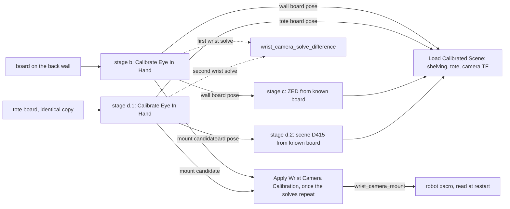

# Board Based Calibration

## At a glance

**The cell is calibrated from two identical 3D-printed ChArUco boards and a handful of measured offsets.** MoveIt Pro 10.2's hand-eye calibration solves the wrist camera. The wrist camera then registers each board in the world. The two fixed cameras and the scene furniture are placed from those two registered poses. Single AprilTags are no longer used.

The two boards:
- **Wall board** (stages b and c): fixed in the middle of the shelving's back wall, below the top rack, seen by the wrist camera and the `shelf_cam` ZED.
- **Tote board** (stage d): lying face up on the floor of the empty tote, seen by the wrist camera and the original `scene_camera` D415.

Neither board moves between stages.

The Objectives live in `picknik_009_ur5e_hw_config/objectives/` (subcategory `3. Calibration Routine`). **One run calibrates everything:** [`Calibrate Cameras`](../src/picknik_009_ur5e_hw_config/objectives/calibrate_cameras.xml) runs `Calibrate Shelf Cam From Wall Board`, then runs `Calibrate Scene Camera From Tote Board`. Each of those two runs its wrist stage first (b before c, d.1 before d.2), so a fixed camera always uses a board pose saved in the same run. The stages below still run on their own, for example to redo one part:

| Stage | Objective | Result |
|---|---|---|
| b | [`Calibrate Wrist Camera On Wall Board`](../src/picknik_009_ur5e_hw_config/objectives/calibrate_wrist_camera_on_wall_board.xml) | wrist camera solve, back-wall board pose, wall-board wrist mount candidate |
| c | [`Calibrate Shelf Cam From Wall Board`](../src/picknik_009_ur5e_hw_config/objectives/calibrate_shelf_cam_from_wall_board.xml) | `shelf_cam` root link pose |
| d.1 | [`Calibrate Wrist Camera On Tote Board`](../src/picknik_009_ur5e_hw_config/objectives/calibrate_wrist_camera_on_tote_board.xml) | a second wrist camera solve, the tote board pose, the difference between the two wrist solves, tote-board wrist mount candidate |
| d.2 | [`Calibrate Scene Camera From Tote Board`](../src/picknik_009_ur5e_hw_config/objectives/calibrate_scene_camera_from_tote_board.xml) | `scene_camera_link` pose |

After a run, restart the stack once. The wrist result is not applied by the run; `Apply Wrist Camera Calibration` does that once the wrist solves repeat (see Notes and gotchas).

The measurements (board poses, fixed-camera poses, the wall wrist solve, the difference between the two wrist solves, the two wrist mount candidates and the applied `wrist_camera_mount`) go into named sections of one file, [`cell_calibration.yaml`](../src/picknik_009_ur5e_config/objectives/calibration/cell_calibration.yaml). They are written with the product's `SavePoseStampedToYaml` (`overwrite="false"` plus a `namespace`) and read with `LoadPoseStampedFromYamlNamespace`. [`Load Calibrated Scene`](../src/picknik_009_ur5e_config/objectives/load_calibrated_scene.xml) reads the camera sections and re-publishes the camera transforms after every restart. The saver rewrites the file and drops comments, so the section meanings live here, not in the file.

The board's print file, its `board` port value, its orientation reference image and the camera sizing table are kept outside the repo with the calibration report. The same value is the default of every calibration Objective's `board` port.

## Why this shape

- **The wrist camera comes first because everything else hangs off it.** The old AprilTag chain trusted the wrist camera's CAD pose. Every tag, shelf and scene-camera pose inherited that unmeasured error. Now the 10.2 eye-in-hand solve measures the wrist camera directly.
- **The eye-in-hand solve also returns the board's world pose.** That is what makes the fixed cameras and the furniture cheap: they only need a board whose world pose is already known.
- **Two copies of one board, so nothing moves between stages.** Each copy stays put from its first stage to its last. Stage b saves the wall pose to the `wall_board` section before anything else can fail, and stage c and `Load Calibrated Scene` read only that section, never the live board. Copies of one print share one dictionary; that is safe only because no camera sees both boards.
- **Stage d.1 is a second full eye-in-hand run, not a composition.** It was chosen over a composition. It needs no extra tree logic. It also gives an independent second wrist solve: the two solves should agree, and the `wrist_camera_solve_difference` section shows by how much.
- **No restart between stages.** Both eye-in-hand runs take the end-effector pose from forward kinematics, not from the wrist camera's URDF pose. So both board poses are valid before the new wrist pose is in the xacro. A restart is needed only before normal use of the wrist camera.
- **Fixed cameras use a composition of existing Behaviors** ([`Calibrate Fixed Camera From Known Board`](../src/picknik_009_ur5e_hw_config/objectives/calibrate_fixed_camera_from_known_board.xml)).
  - No 10.2 Objective covers a fixed camera looking at a fixed board: its eye-to-hand path assumes the board rides on the arm.
  - The math is `world_T_camera = world_T_board · camera_T_board⁻¹`, done by the workspace Behavior `ComputeCameraPoseFromTag`. Its output takes the frame of its first input, so the wrist mount conversion reuses it in other frames.
  - Product `TransformPoseWithPose` cannot invert, and `CalculatePoseOffset` needs the very TF that is unknown.
- **The fixed-camera result is converted to the camera's root link using the driver's own link-to-optical transform** (`GetLatestTransform`). The old scene-camera chain detected in the color image but labelled the result as the depth optical frame, then converted with a fixed rotation. The new path uses the frame the image actually has.
- **Placement uses only the board's position; orientations stay world-aligned.** The wall and base stay square to world, the racks keep their half-turn yaw, and the tote stays square to world, as in the AprilTag chain. A board stuck a few degrees off-square on a wall would otherwise swing the whole shelving.
- **All offsets live in one file, one named section each** ([`board_offsets.yaml`](../src/picknik_009_ur5e_config/objectives/calibration/board_offsets.yaml)). The workspace Behavior `ReadYamlValue` reads one section's `xyz` text, and `TransformPose` applies it in the input pose's own frame. One file keeps every number the operator might edit in one place.
  - Two sections are **measured on the cell**: `wall_corner_in_wall_board` and `tote_outer_corner_in_tote_board`. They hold the operator's measurements for the current board positions; re-measure them whenever a board is re-mounted. They come first in the file.
  - The others are geometry, with defaults taken from the current calibration and from `bin_tote.urdf`. Each section's comment says what it is.
  - No product YAML loader can read one section of a file, so the shipped `LoadVector3FromYaml` (one file per value) was replaced. `TransformPose` accepts its offset as `x;y;z` text, so no new C++ was needed.

## The board frame

**A board pose from 10.2 is the pose of the pattern's top-left outer corner** (the outer corner of the top-left square of the printed checker pattern). Its axes:
- x points right along the top edge;
- y points down the page;
- z points into the page, away from the viewer.

Both `DetectCharucoBoard` and the eye-in-hand solver use OpenCV's `getChessboardCorners()` object points. OpenCV draws the board with object y running down the image rows. A synthetic PnP check confirms that the origin projects onto the pattern's top-left pixel.

**Know which corner is the origin before mounting.** All four corner squares of this board are black, so it looks the same turned half a turn. Only the marker IDs fix the origin. Mounted the wrong way round, the detected origin lands on the opposite corner and every measured offset is wrong by the pattern's diagonal. Match the print once to the orientation reference image kept with the calibration report, and mark the origin corner and the top edge on the back of the board.

Mounting rules that the measured offsets assume:
- **On the back wall:** upright (marked top edge up), pattern face toward the robot, in the middle of the wall below the top rack. The measured offset still runs from the pattern corner to the wall's front-face top-left corner, as seen from the robot; that corner is now a long way from the board.
- **In the tote:** pattern face up, turned a quarter turn from the wall board: board +x along world −y (away from the robot), board +y along world −x, board +z down. The origin corner sits in the tote's corner on the world +x (operator's left) and robot side. The measured offset runs from the pattern corner to the tote's **outer** corner on that side, at floor height: the operator measures to the outer surfaces, which are easier to reach than the inner walls, and the tote's outer size comes from `bin_tote.urdf`.
- **Tote wall thickness check (UNVERIFIED).** With the URDF's wall thickness, the measured position puts the pattern's robot-side edge on the inner wall face, so the board's white border would sit inside the wall. Either the real wall is thinner than the URDF's or the measurement was taken at the rim. The outer-corner offset does not depend on the wall thickness, but the tote's collision walls do.

Measure from the pattern corner: the outer corner of the black squares. Never measure from the board's outer edge. The white border around the pattern is not part of the pattern; its width is in the report.

## Calibration-only camera resolution

**The board is small enough to print at home, so the cameras run at a higher resolution while calibrating.**
- `cameras.launch.xml` takes a `calibration_mode` argument, default off. On, it raises the D415 color profile and gives the ZED its calibration parameter file (full resolution, no downscale).
- The thin config package `picknik_009_ur5e_hw_calibration_config` turns it on. It is based on `picknik_009_ur5e_hw_config` and only swaps the drivers launch file. Select it for calibration sessions only; normal runs never see the change.
- The pose solves read `camera_info` live, so they use the lens model of whatever resolution is running. The solved optical-frame pose belongs to the same physical sensor at any resolution.

## The 3D-printed board

**A printed board is only as good as its square size, flatness and contrast.** The pose solves trust the `board` port's square and marker lengths exactly.
- **Measure the printed square.** Measure across several squares with calipers and divide by the number of squares. If the result differs from `square_length`, put the measured value in every calibration Objective's `board` port, and scale `marker_length` by the same ratio. Plastic shrinks a little as it cools, so a measured value is better than the design value.
- **Flatness.** The print is a thin plate, not a stiff board, and it is mounted directly on the wall surface and the tote floor with no backing. It must lie flat on that surface with no warp: a bent board breaks the flat-pattern model that every pose solve assumes. The face offsets `t` and `t_b` are then just the print thickness. The print file's thickness is used; a caliper reading of about twice that was taken and set aside as a likely mis-measurement.
- **The pattern face is the side that lay on the print bed.** The top of the print is plain white. A textured bed gives a matte pattern face; a smooth bed gives a glossy one, which reflects light into the cameras.
- **Matte, no glare.** Glare on a square hides its corner from the detector. Use matte filament where possible, and light the board from the side, not from behind the camera.
- **Contrast.** The black squares are one thin layer over white. Check that the black is solid and the white shows no black through it. The slicer file names white and black parts but does not fix the filament colours; load white and black before printing.

## Notes and gotchas

- **A board solve does not check the pick chain.** To measure what the wrist camera's pick points actually hit, from several arm poses, use [`Check Wrist Camera By Touch-Off`](wrist_camera_touch_off_check.md). The hardware config loads the arm's factory kinematics (`use_calibrated_kinematics`; see that doc), so solves taken before that change were made against slightly different forward kinematics and should be re-run.

- **Each eye-in-hand stage's views are saved waypoints.** They live in the base config's [`ur_waypoints.yaml`](../src/picknik_009_ur5e_config/waypoints/ur_waypoints.yaml), shared by sim and hw. The product visits every waypoint whose name starts with the stage's `waypoint_prefix`, in name order, and the solve fails below its minimum sample count. Zero-pad numbers once a prefix reaches ten views, so they keep sorting in order. No other waypoint may start with a stage's prefix.
- **When a board may move.** The wall board must stay put from the start of stage b until stage c has finished, because stage c's ZED solve uses the wall pose stage b saved. The tote board and the tote must stay put from the start of stage d.1 until stage d.2 has finished.
- **Moving the wall board means re-running stages b and c.** A re-mounted board is never in exactly the same place, so the saved wall pose no longer matches it. `Load Calibrated Scene` is still correct, because it uses the saved pose, not the board.
- **Both boards carry the same marker IDs.** The boards are far enough apart that no camera sees both, so neither is covered. If either board is moved so that one camera could see both, they could be confused.
- **The top rack roofs the wall board.** The board sits just below the top rack, and the rack reaches well out from the wall. A camera sees the whole pattern only from about the board's height or lower; views from above the rack line are cut off at the board's top edge. This matters for the wrist views and for where the ZED is mounted. The bottom rack is well below the board and does not block level views.
- **A mid-wall board makes the wall placement depend more on the board being square.** The offset to the wall corner is applied in the board's frame, so the corner moves by the offset's length times the angle the board is turned: about 1.4 cm per degree at the current mid-wall position (the offset is about 0.8 m long). Mount the board level and flat against the wall. A wall that is not square to world adds its own error, as before, because the rest of the shelving is placed square to world from the corner.
- **The wall-corner offset is fitted to the AprilTag shelving, not measured (since 2026-10-16).** The operator's measured `wall_corner_in_wall_board` placed the wall, both racks and the shelf base 45 mm low and 16 mm nearer the robot than the AprilTag poses (the deleted `top_shelf_pose.yaml` etc.). Placing had used those poses for months, and with the measured value places hit the rack and tipped the product. All four poses moved by the same vector, so the per-rack offsets agree with the old calibration and only the shared corner disagrees. The section now holds the value that put all four back on the AprilTag poses. A touch-off then moved all four together by a few centimetres. The suction cup was pressed against the top rack's front face, centred on it top to bottom and at its right end as seen from the robot. The model's front face, face centre and right end were then moved onto the cup. Touch off from the cup lip, `epick_tip`, not from `grasp_link`. `grasp_link` (= `epick_tcp`) sits a few millimetres short of the lip, so using it leaves the rack modelled that much too close to the robot. Note also that the face's centre is not the rack's top surface: the rack frame's z = 0 is the top surface, and the front face hangs below it, so the mesh's face extent sets the offset between the two. The fit moves the racks rigidly, so the bottom rack follows the top one's correction. If the bottom rack is off on its own, that is a `bottom_rack_from_wall_corner` question. Its 16 mm off the wall face is not physical, so it shows that one of the three inputs is off (the hand measurement, the wall board solve or the old poses) without saying which. Before replacing it with a fresh measurement, touch off a rack surface with the suction cup and check the result against the scene. The tote and the fixed cameras do not use this offset, so the camera calibration is unaffected.
- **The rack mesh is the real 48" rack (since 2026-10-20).** `chunky_shelf_only.stl` used to be 50" long with a lip more than twice the real one's height, so a fit at one end left the other end ~5 cm off, and the front-face height fit left the modelled top surface ~2 cm high. The mesh was cut to the tape-measured length and lip height, keeping its origin (centre in x, top surface, behind the lip), and both rack offsets were refitted to touches. The **bottom rack** height is set to a top-surface touch at its right front corner (its high end, see below) and its x is centred between the left and right front-corner touches. The **top rack** height is set to a top-surface touch near its right end (cup laid flat on its side: surface = `epick_tip` z minus the 40 mm cup's radius, not the xacro's `epick_suction_cup_radius`, which is a collision placeholder), and its right end was kept where the front-face touch put it; its left end has not been touched off. The shared wall corner was left alone, so the back wall and base did not move. Set rack height from a top-surface touch, never from the face.
  - **The racks are not level, and the model cannot follow them.** Bottom-rack touches at the left and right front corners differ by about 2 cm in height (left lower), while the racks are modelled square to world. **Set a sloping rack's height at its high end.** The model is then above the real shelf everywhere else, and `Move Down to Contact with Admittance` closes the gap and stops on force. With the height at the low end, the place pose itself is inside the real shelf on the high half. The product is pressed in on arrival, the descent trips at once, and `Push Product into Shelf with Admittance` aborts on goal tolerance while dragging the jammed product. Both are wrapped in `ForceSuccess`, so the episode is still saved. In `Load Calibrated Scene` the cup then looks like it's floating at the low end. Cup-lip touches also read low by however much the bellows compress, which varies with how hard the cup is pressed (two right-corner touches differed by 1 cm). Repeat a touch before trusting it, with the whole cup on the surface.
  - **The slot geometry follows the rack.** `kShelfWidth` in [`shelf_geometry.hpp`](../src/shelf_stocking_behaviors/include/shelf_stocking_behaviors/shelf_geometry.hpp) spreads the six slots evenly over the rack, centred on the rack origin. It is a C++ constant, not read from the mesh, so a rack size change must update both, then build. It moves every hardware place pose and the keep-out boxes. The back-wall and base boxes in `Load Calibrated Scene` are also still 50" wide; they were not measured.
- **Every caller of `Load Calibrated Scene` must remap its output ports.** It declares `top_shelf_pose`, `bottom_shelf_pose` and `bin_calibrated_pose` as output ports with no default, and BehaviorTree.CPP refuses to build a tree whose SubTree call leaves one unmapped ("defining a mandatory port called [bin_calibrated_pose], but you are not remapping it"; it names only the first missing port alphabetically). Stages c and d.2 map all three, the same way `Shelf Stocking Main Application` does. Adding a port to `Load Calibrated Scene` breaks every bare call to it.
- **The scene camera and the tote are corrected by touch-off, not by the stage d solves (since 2026-10-16).** The scene camera's cloud sat about 2 cm off the real tote, and grasps missed. The cup was rested on the tote rim with the cup centred on the rim at four places: both robot-side corners, and mid-span on the robot-side and far walls. The `epick_tip` positions were recorded from TF. Those points fixed the real tote: its position, its rim height, and that it is square to world. The bin model was off by about 2 cm, mostly toward the robot, so `tote_outer_corner_in_tote_board` was refitted to put the model on it. Then one scene-camera cloud was fitted to the touched tote: inner wall faces, rim tops, and a floor parallel to the rim at a free depth, with the gripper's neighbourhood cut out. The rigid correction that brought every surface to within about 2 mm was applied to `scene_camera_link`. Both sections carry a comment with the replaced values.
  - **Why corners are a poor reference for x and y.** A cup resting on the rim "at the corner" can sit anywhere within about a cup radius of it, so the two corner points fixed only the rim height and the tote's x (assuming the cup sat equally far in at both). Mid-span points with the cup centred across the rim's width give a wall's centre line to a few mm. A third mid-span point, on the +x wall, would remove the equal-inset assumption for x.
  - **Why the tote's own turn had to be measured first.** The tote board pose is turned about 1.4° from square, while the tote model is kept square to world. A cloud fitted to the model alone cannot tell a camera turn from a tote turn. The two robot-side corners differ by a few mm over the wall's length, so the tote is square and the fitted turn belongs to the camera.
  - **What the model cannot follow.** The touched rim slopes about 1° (far side lower), and the floor in the corrected cloud is parallel to it. The square-to-world tote matches the rim at its centre only, so the near rim is modelled a few mm low and the far rim a few mm high. The fitted floor sits a few mm above the model's floor, because the URDF wall is a little taller than the real one.
  - **A later cloud check moved the camera toward the robot (2026-10-20).** A live cloud measured against the model tote put both rim tops' centres on the far side of the model, by about the same amount, with the wall spacing matching and the robot-side inner face vertical. That is a shift, not a turn, so only the camera's world y was changed. It assumes the tote had not moved since the touch-off; if a cup centred on the robot-side rim no longer lands on the model rim, the tote moved and the tote offset is what needs refitting. Height was left alone, because the near and far rims straddle the model by about the rim's own slope. Measure rim-top centres for y, not the inner faces: the faces fit only as well as the URDF wall thickness matches the real wall.
  - **What undoes it.** Re-running stage d.2 overwrites `scene_camera_link`, and a fresh tote measurement replaces the tote offset. If you re-run them, check the cloud against the rim again, because the stage d.2 solve was the one that was off. The fit scripts were run ad hoc and are not in the repo.
- **Take the tote board out of the tote after stage d.** Nothing at run time reads it. Its results live in the `tote_board` and `scene_camera_link` sections of `cell_calibration.yaml`. If the tote is moved later, put the board back in and re-run d.1 and d.2.
- **A new ZED mount changes no Objective.** Stage c solves the ZED from wherever it is. Re-run stage c after the move, and check the new distance and angle against the camera sizing table in the report. If the board must also move to stay in the ZED's view, re-measure the `wall_corner_in_wall_board` section of `board_offsets.yaml` and re-run stages b and c.
- **The fixed-camera loop needs the board in the first image.** A frame without a board pose keeps the previous pose on the blackboard, so later misses repeat the last good pose rather than failing.
- **The image `frame_id` must equal the `camera_optical_frame` port.** The conversion to the root link looks up that frame, but no Behavior reads the image header's frame for it.
  - For the D415s this is the color optical frame.
  - For the ZED it is the left camera optical frame of the rectified image ([`zed_shelf_cam.md`](zed_shelf_cam.md)). Confirm it from `camera_info` on the live system.
- **The shelving and tote are worked out at every load, not stored.** `Load Calibrated Scene` loads the two board poses and calls `Place Shelving From Wall Board` and `Place Tote From Tote Board` (base config, so sim can load them), which apply the offsets and output the poses. An edit to `board_offsets.yaml` therefore counts at the next run, with no re-placement step. The stages c and d.2 end by running `Load Calibrated Scene`, so the current run sees the new scene and camera transforms at once.
- **Who publishes the fixed-camera transforms.** On hardware, the drivers launch file ([`robot_drivers_to_persist.launch.py`](../src/picknik_009_ur5e_hw_config/launch/robot_drivers_to_persist.launch.py)) starts one static transform publisher per fixed camera from the camera sections of `cell_calibration.yaml` when the stack starts, before any Objective runs. `Load Calibrated Scene` also publishes them, for sim and for the current run after a calibration. After a calibration the launch publisher still holds the old pose until the next stack restart, and a node that connects later can receive either pose. So **restart the stack once after calibrating**; the wrist camera needs that restart anyway.
- **`LoadPoseStampedFromYamlNamespace` reads one pose from a shared file.** It is the product's `LoadPoseStampedFromYaml` plus a `namespace` port, meaning the same as `SavePoseStampedToYaml`'s: the section that saver writes into. The product loader can only read a whole file. Nothing in it knows about this cell; its relation to the product code is in `docs/AGENT_COMMENTS.md`.
- **The offsets file is read from the installed package, not the source tree.** Every other calibration file uses a `~/user_ws/src/...` path, but `ReadYamlValue` resolves the package's share directory. So a newly added `board_offsets.yaml` needs one rebuild. After that, edits show through without a rebuild only because the workspace builds with symlink-install (`colcon-defaults.yaml`). UNVERIFIED that `moveit_pro build` on the Agent PC honours it; if an edit seems ignored, rebuild.
- **Each section's `xyz` must stay one quoted `x;y;z` scalar.** `ReadYamlValue` fails on a list or a map.
- **Each offset's text must reach the blackboard before any typed use of its key.** The text-to-Vector3 conversion works only when the text-typed port is created first (BehaviorTree.CPP 4.9 tree-creation check). A node that touches one of these keys with a Vector3 port before its `ReadYamlValue` makes the tree fail to load. Runtime UNVERIFIED: checked against upstream BehaviorTree.CPP 4.9.0 source, and the PickNik fork that MoveIt Pro 10.2 pins is assumed to match.
- **Results are written with absolute `~/user_ws/src/picknik_009_ur5e_config/...` paths.** `SavePoseStampedToYaml` resolves a relative path against the *active* config's objectives directory, which is the hw or calibration package, not the base package that `Load Calibrated Scene` reads.
- **The tote's old 1.27 cm "lower the bin" step is gone.** `Load Calibrated Scene` used to lower the tote URDF to correct the AprilTag opening reference. The board chain measures the floor directly and gives the `bin_tote.urdf` origin as is.
- **The VLA camera rig may block views of the board in the tote (UNVERIFIED).** The rig ([`vla_scene_cam_rig.md`](vla_scene_cam_rig.md)) stands on the world −x side of the tote, the side where the board sits in stage d. It is placed by touch-off, not by the boards, so a calibration run does not move it.
- **The committed results come from one on-cell session.** The board poses, camera poses and wrist solves in `cell_calibration.yaml` were all written by stages b to d.2 in a single run on the cell. The two wrist solves disagree by a few centimetres in that run and in an earlier one, so neither is applied. That session predates the mount candidates, so the file has none yet.
- **`wrist_camera_mount` holds the 2026-11-02 wall-board solve, applied 2026-11-03; before that it held a hand-tuned offset.** The wall-board candidate from the stage b run described in the known-bug note below was applied after `Test Wrist Camera Calibration` showed it landing closer than the hand-tuned mount. The hand-tuned offset is kept as `wrist_camera_mount_candidate_hand_tuned`. How it was made: the mount was the identity pose (the CAD mount) until 2026-11-02. Picks from the wrist camera then landed short. With the arm at `unShelve Start`, the cup was teleopped onto the top of a pringles can using only the wrist cloud, and the real can turned out 1.5 cm further in world +Y (away from the robot) than the cloud showed. The mount was shifted 1.5 cm along world **−Y** as seen from `unShelve Start`, expressed in `d415_mount_link`. Getting the sign right is not obvious. The first edit shifted it along world +Y, reasoning that the cloud moves with the modelled camera, and on the cell that pushed the error further out, so the sign was flipped. Check the direction by touch-off after any hand edit rather than trusting the reasoning. It is a translation only, so it is exact at that pose and distance; a tilt in the real error would show up as a residual at other poses. The next `Apply Wrist Camera Calibration` overwrites it, and so does any saver run that rewrites the section.
- **Known bug: re-running stage b to recalibrate the wrist camera can break the shelf calibration (2026-11-02, cause not found).** Stage b saves the wall board pose as well as the wrist solve, and the wall, both racks and the shelf base are all placed from that `wall_board` section. On the 2026-11-02 run the wrist solve came out close to the previous one, but the saved `wall_board` pose had moved by about a board's width and was rotated by about 90°, so the shelves were modelled in the wrong place. The board had not been moved. One hypothesis, not yet checked: the detector picked a different origin corner, since all four corner squares are black (see the board frame section above). The run's output is kept beside the file as `cell_calibration.backup-20261102-bad-wall-board.yaml`. `cell_calibration.yaml` was restored to its state before the run, except that the run's wrist solve and wall-board mount candidate were copied back in, so `Apply Wrist Camera Calibration` can apply them. The hand-tuned mount in use before the run is kept as `wrist_camera_mount_candidate_hand_tuned`. `Apply Wrist Camera Calibration` reads its candidate from its `candidate_section` default, because the UI does not pass Objective inputs, so going back to the hand-tuned mount means changing that default. The run also stripped the comments from the file, because the saver rewrites the whole YAML. Until this is fixed, check `wall_board` with `git diff` after every stage b run, before restarting the stack. If it moved, restore that section from git; the wrist sections from the same run can be kept.
- **The wrist camera's place in the robot model comes from `cell_calibration.yaml`.** The robot xacro reads the `wrist_camera_mount` section with `xacro.load_yaml` and uses it as the camera's origin on `d415_mount_link`. The robot model is built at stack start, so a change needs a restart.
  - **The solve is not the xacro origin.** The solve is the color optical frame in `grasp_link`; the xacro origin is the camera's bottom screw frame in `d415_mount_link`. `Compute Wrist Camera Mount From Solve` converts one into the other with the camera's internal frames and the `grasp_link` to `d415_mount_link` chain, read from live TF. Neither depends on the mount origin in use, so applying a candidate twice gives the same model, not a doubled correction.
  - **The stored rotation is a quaternion; the xacro turns it into roll, pitch, yaw.** Checked by expanding the xacro with a candidate from the committed wall solve: the optical frame in `grasp_link` matched the solve exactly.
  - **The xacro reads the installed package's copy**, like `board_offsets.yaml`: with symlink-install an applied candidate shows at the next restart, otherwise it needs a rebuild first.
  - **The sim's MuJoCo wrist camera does not follow** an applied candidate. Sim uses the same xacro, so its robot model moves, but the rendered camera sits in the robot MJCF, which the build does not generate.
- **Applying a wrist solve is a deliberate step.** Each wrist stage saves a mount candidate (`wrist_camera_mount_candidate_wall_board`, `wrist_camera_mount_candidate_tote_board`) but changes nothing the robot uses. Once two `Calibrate Cameras` runs give candidates and a `wrist_camera_solve_difference` that agree, run `Apply Wrist Camera Calibration` with the candidate to use, then restart the stack. It copies the candidate into `wrist_camera_mount`. To undo, restore that section from git.
- **The sim's MuJoCo shelving, tote and fixed cameras follow `cell_calibration.yaml` at build time.** MuJoCo cannot read YAML, so the sim package build runs [`generate_calibrated_scene_mjcf.py`](../src/picknik_009_ur5e_config_sim/scripts/generate_calibrated_scene_mjcf.py) on the installed `cell_calibration.yaml` and `board_offsets.yaml`. It fills [`calibrated_scene.xml.in`](../src/picknik_009_ur5e_config_sim/templates/calibrated_scene.xml.in) and installs the result as `mjcf/assets/calibrated_scene.xml`, which `additions.xml` includes. In sim, `Load Calibrated Scene` reads the same file, so the MuJoCo bodies and the planning scene agree.
  - **The sim needs one rebuild after a calibration.** The build regenerates the file only when one of its inputs changed. Until then the sim renders the old poses while `Load Calibrated Scene` uses the new ones.
  - **The script repeats the placement subtrees' arithmetic.** `Place Shelving From Wall Board` and `Place Tote From Tote Board` cannot run at build time, so a change to their math must be made in the script too. The script checks only that the sections exist; the two were compared on the committed results and agreed exactly.
  - **The flanking shelf rows and their products ride the calibrated shelving.** Each row is a body offset sideways from the calibrated unit, and the decorative products sit inside a body placed at the calibrated back wall. None of these have joints, so the keyframes are untouched.
  - **The free products do not follow the tote.** They and the keyframes are world positions, so a tote move can leave one outside the walls. Run `scripts/check_sim_products_in_bin.py` after a calibration that moves the tote (see [`mujoco_sim_config.md`](mujoco_sim_config.md)).
  - **The tote now sits where the planning scene puts it.** The old MuJoCo tote was 1.27 cm above the planning-scene tote, because only the planning scene had the AprilTag-era lowering.
- **Table, workcell and camera mount plate are unchanged.** `Load Calibrated Scene` still places them at fixed workcell poses. No pole is placed. The tote floor height the tote board measures is not compared with that fixed table height.
- **The Objectives are HW-only.** Their topics are the hardware `/camera/...` topics. Sim has no boards and no wrist camera stream; its ZED and scene camera sit at the calibrated poses but nothing calibrates them in sim.
- **CI dependency install is unverified.** CI skips building the ZED packages, but its dependency-install step may still read `zed_components`' `package.xml`. Whether all of its keys resolve on Jazzy has not been checked.
- **Not verified on hardware.** The ZED driver compile (`zed_components`) and every stage run on the real cell are unverified. The Objective XML passed the MoveIt Pro structural lint, and the config packages built in a 10.2 image.

## Removed AprilTag Objectives

`Calibrate Detected April Tags`, `Detect April Tag Here` and `Calibrate Scene Camera` were removed, with the `april_tag_poses/` folder they read and wrote. Nothing else called them or read their files. The AprilTag detection Behaviors they used come from MoveIt Pro's own Vision and Converter loaders, which other Objectives also need, so no plugin entry changed.

`objectives/calibration/` now holds only `cell_calibration.yaml` and `board_offsets.yaml`. The older files there (AprilTag-era tag, bin-corner, camera, shelf and table poses, plus a few application scratch poses) had no reader in the workspace and were removed; git history keeps them.

`ComputeCameraPoseFromTag` stays: the board chain uses it.
