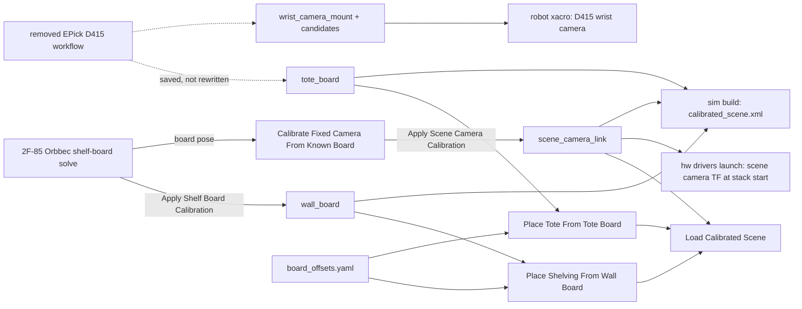

# Board Based Calibration

## At a glance

**The cell is placed from ChArUco board poses and a handful of measured offsets.** A board pose in `world` comes from a MoveIt Pro 10.2 eye-in-hand solve. The shelving, the tote and the fixed scene camera are then placed from those saved poses every time the scene loads. Single AprilTags are no longer used.

This doc covers the parts every config shares:

- **[`cell_calibration.yaml`](../src/picknik_009_ur5e_config/objectives/calibration/cell_calibration.yaml)**, one file of named sections that holds every result: board poses, camera poses, wrist mounts and their candidates, the 2F-85 bin corner. Results are written with the product's `SavePoseStampedToYaml` (`overwrite="false"` plus a `namespace`) and read with the workspace's `LoadPoseStampedFromYamlNamespace`. The saver rewrites the file and drops comments, so the section meanings live in the docs, not in the file.
- **[`board_offsets.yaml`](../src/picknik_009_ur5e_config/objectives/calibration/board_offsets.yaml)**, the measured and geometric offsets from a board to the furniture it places, one named section each.
- **[`Load Calibrated Scene`](../src/picknik_009_ur5e_config/objectives/load_calibrated_scene.xml)** (base config; the EPick cell's scene, used by the sim and the vacuum config) and its 2F-85 override in `picknik_009_ur5e_2f85_hw_config`. Both call `Place Shelving From Wall Board`; the base version also calls `Place Tote From Tote Board`. Both re-publish the scene-camera transform.
- **[`Calibrate Fixed Camera From Known Board`](../src/picknik_009_ur5e_hw_config/objectives/calibrate_fixed_camera_from_known_board.xml)** (gripper-neutral hardware config), the composition that solves a fixed camera against a board whose world pose is already known.
- **The sim scene generation**, which turns the same two files into MuJoCo bodies at build time.

The procedures that write board and camera poses today are the 2F-85's: the [Orbbec shelf-board calibration](orbbec_shelf_board_calibration.md) (the shelf board pose, applied to `wall_board`, and the scene D415, applied to `scene_camera_link`, the latter solved through `Calibrate Fixed Camera From Known Board`) and [`Calibrate Bin`](calibrate_bin.md). The EPick cell's D415 calibration Objectives (a wall board and a tote board, each solved with the wrist D415) were removed with the suction cell; see the last section. Their saved results are still in the file and still read.

## Why this shape

- **An eye-in-hand solve also returns the board's world pose.** That is what makes the fixed scene camera and the furniture cheap: they only need a board whose world pose is already known. The camera on the arm is solved first because everything else hangs off it.
- **The saved board pose is the reference, not the live board.** `Load Calibrated Scene` reads only the saved sections, never a live detection. A re-mounted board is never in exactly the same place, so moving a board means re-running the solve that saves it; until then the scene stays where the saved pose puts it.
- **Fixed cameras use a composition of existing Behaviors** (`Calibrate Fixed Camera From Known Board`).
  - No 10.2 Objective covers a fixed camera looking at a fixed board: its eye-to-hand path assumes the board rides on the arm.
  - The math is `world_T_camera = world_T_board · camera_T_board⁻¹`, done by the workspace Behavior `ComputeCameraPoseFromTag`. Its output takes the frame of its first input, so the wrist mount conversions reuse it in other frames.
  - Product `TransformPoseWithPose` cannot invert, and `CalculatePoseOffset` needs the very TF that is unknown.
- **The fixed-camera result is converted to the camera's root link using the driver's own link-to-optical transform** (`GetLatestTransform`). The old AprilTag scene-camera chain detected in the color image but labelled the result as the depth optical frame, then converted with a fixed rotation. This path uses the frame the image actually has.
- **Placement uses only the board's position; orientations stay world-aligned.** The wall and base stay square to world, the racks keep their half-turn yaw, and the tote stays square to world. A board stuck a few degrees off-square on a wall would otherwise swing the whole shelving.
- **All offsets live in one file, one named section each.** The workspace Behavior `ReadYamlValue` reads one section's `xyz` text, and `TransformPose` applies it in the input pose's own frame. One file keeps every number the operator might edit in one place.
  - Two sections are **measured on the cell**: `wall_corner_in_wall_board` and `tote_outer_corner_in_tote_board`. They hold the measurements for the board positions they were taken at; re-measure them whenever a board is re-mounted. They come first in the file.
  - The others are geometry, with defaults taken from the calibration and from `bin_tote.urdf`. Each section's comment says what it is.
  - No product YAML loader can read one section of a file, so the shipped `LoadVector3FromYaml` (one file per value) was replaced. `TransformPose` accepts its offset as `x;y;z` text, so no new C++ was needed.
- **The shelving and tote are worked out at every load, not stored.** `Load Calibrated Scene` loads the board poses and calls the two placement subtrees (base config, so the sim can load them too), which apply the offsets and output the poses. An edit to `board_offsets.yaml` therefore counts at the next run, with no re-placement step.

## The board frame

**A board pose from 10.2 is the pose of the pattern's top-left outer corner** (the outer corner of the top-left square of the printed checker pattern). Its axes:
- x points right along the top edge;
- y points down the page;
- z points into the page, away from the viewer.

Both `DetectCharucoBoard` and the eye-in-hand solver use OpenCV's `getChessboardCorners()` object points. OpenCV draws the board with object y running down the image rows. A synthetic PnP check confirms that the origin projects onto the pattern's top-left pixel.

**Know which corner is the origin before mounting.** All four corner squares of this board are black, so it looks the same turned half a turn. Only the marker IDs fix the origin. Mounted the wrong way round, the detected origin lands on the opposite corner and every measured offset is wrong by the pattern's diagonal. Match the print once to the orientation reference image kept with the calibration report, and mark the origin corner and the top edge on the back of the board.

Mounting rules that the measured offsets assume:
- **On the back wall:** upright (marked top edge up), pattern face toward the robot, in the middle of the wall below the top rack. The measured offset runs from the pattern corner to the wall's front-face top-left corner, as seen from the robot.
- **In the tote (the saved `tote_board` pose):** pattern face up, turned a quarter turn from the wall board, origin corner in the tote's corner on the world +x and robot side. Its offset runs from the pattern corner to the tote's **outer** corner on that side, at floor height, because the outer surfaces are easier to reach than the inner walls; the tote's outer size comes from `bin_tote.urdf`. With the URDF's wall thickness the measured position puts the board's white border inside the wall, so either the real wall is thinner than the URDF's or the measurement was taken at the rim (UNVERIFIED). The outer-corner offset does not depend on the wall thickness, but the tote's collision walls do.

Measure from the pattern corner: the outer corner of the black squares. Never measure from the board's outer edge. The white border around the pattern is not part of the pattern; its width is in the report.

## Calibration-only camera resolution

**The board is small enough to print at home, so the D415s can run a higher-resolution color profile while calibrating. Nothing turns it on for you: switch it on by hand before a calibration session and off again afterwards.** It is optional. The solves also work at the normal profile, with fewer pixels on the board, which matters most for a fixed camera far from its board, such as the 2F-85 scene D415 on the stand-corner pole.

- **What it changes.** `calibration_mode` in [`cameras.launch.xml`](../src/picknik_009_ur5e_hw_config/launch/cameras.launch.xml) switches only the D415 color profile (both D415s on the EPick cell, the scene D415 on the 2F-85). The wrist Orbbec is unchanged.
- **Where to set it.** The value that counts is the `default_value` of the `calibration_mode` launch argument in the drivers launch of the leaf config you run: [`picknik_009_ur5e_2f85_hw_config`'s](../src/picknik_009_ur5e_2f85_hw_config/launch/robot_drivers_to_persist.launch.py) for the 2F-85, [`picknik_009_ur5e_vacuum_config`'s](../src/picknik_009_ur5e_vacuum_config/launch/robot_drivers_to_persist.launch.py) for the EPick cell. Each passes its value down through the gripper-neutral hardware launch to `cameras.launch.xml`, so the defaults in those two files are never used. MoveIt Pro starts the drivers launch without arguments, so there is no command-line switch.
- **Before running the calibration Objectives:** set that `default_value` to `"true"` and restart the stack. No build is needed, because the launch files are symlink-installed. Before the first stage, check that the scene camera's `color/camera_info` reports the calibration resolution from `cameras.launch.xml`. If `scripts/monitor_scene_camera.sh` is running, restart it with `CALIBRATION_MODE=1`. Otherwise, a camera it relaunches comes back at the normal profile partway through the session.
- **Afterwards:** set it back to `"false"` and restart. Never commit `"true"`. The calibration profile runs color slower than the Trainer records, so episodes recorded while it is on are unusable (see the comment above the profile in `cameras.launch.xml`).
- **Why there is no calibration config package.** A thin `picknik_009_ur5e_hw_calibration_config` used to pass `calibration_mode:=true`. It was based on the EPick hardware config, so it could never start the 2F-85 cell, and its one setting did not justify another config to keep building.
- The pose solves read `camera_info` live, so they use the lens model of whatever resolution is running. The solved optical-frame pose belongs to the same physical sensor at any resolution, so a calibration made in either profile is valid in the other.

## The 3D-printed board

**A printed board is only as good as its square size, flatness and contrast.** The pose solves trust the `board` port's square and marker lengths exactly.
- **Measure the printed square.** Measure across several squares with calipers and divide by the number of squares. If the result differs from `square_length`, put the measured value in every calibration Objective's `board` port, and scale `marker_length` by the same ratio. Plastic shrinks a little as it cools, so a measured value is better than the design value.
- **Flatness.** The print is a thin plate, not a stiff board, mounted directly on the wall surface with no backing. It must lie flat with no warp: a bent board breaks the flat-pattern model that every pose solve assumes. The face offsets are then just the print thickness.
- **The pattern face is the side that lay on the print bed.** The top of the print is plain white. A textured bed gives a matte pattern face; a smooth bed gives a glossy one, which reflects light into the cameras.
- **Matte, no glare.** Glare on a square hides its corner from the detector. Use matte filament where possible, and light the board from the side, not from behind the camera.
- **Contrast.** The black squares are one thin layer over white. Check that the black is solid and the white shows no black through it. The slicer file names white and black parts but does not fix the filament colours; load white and black before printing.

The board's print file, its `board` port value, its orientation reference image and the camera sizing table are kept outside the repo with the calibration report.

## Notes and gotchas

- **Eye-in-hand views are saved waypoints.** They live in the base config's [`ur_waypoints.yaml`](../src/picknik_009_ur5e_config/waypoints/ur_waypoints.yaml). The product visits every waypoint whose name starts with the solve's `waypoint_prefix`, in name order, and the solve fails below its minimum sample count. Zero-pad numbers once a prefix reaches ten views, so they keep sorting in order. No other waypoint may start with that prefix.
- **The top rack roofs the wall board.** The board sits just below the top rack, and the rack reaches well out from the wall. A camera sees the whole pattern only from about the board's height or lower; views from above the rack line are cut off at the board's top edge.
- **A mid-wall board makes the wall placement depend more on the board being square.** The offset to the wall corner is applied in the board's frame, so the corner moves by the offset's length times the angle the board is turned: about 1.4 cm per degree at the current mid-wall position. Mount the board level and flat against the wall. A wall that is not square to world adds its own error, because the rest of the shelving is placed square to world from the corner.
- **Diff `wall_board` against git after any run that writes it.** An EPick wrist solve once saved a `wall_board` pose about a board's width off and turned about 90°, with the board unmoved (cause not found; possibly the detector taking another black corner as the origin). That run's output is kept as `cell_calibration.backup-20261102-bad-wall-board.yaml`. The 2F-85 workflow saves a candidate and applies it to `wall_board` only on request, for this reason.
- **The wall-corner offset is fitted, not measured (since 2026-10-16).** The operator's measured `wall_corner_in_wall_board` placed the wall, both racks and the shelf base 45 mm low and 16 mm nearer the robot than the AprilTag poses that placing had used for months, and places hit the rack. All four poses moved by the same vector, so only the shared corner disagreed. The section holds the value that put all four back, then moved together by a suction-cup touch-off on the top rack's front face. Its 16 mm off the wall face is not physical, so one of the inputs (the hand measurement, the wall board solve or the old poses) is off without saying which. Before replacing it with a fresh measurement, touch off a rack surface and check the result against the scene. Touch off from the contact point (for the EPick the cup lip, `epick_tip`, not `grasp_link`), and remember the rack frame's z = 0 is the top surface, with the front face hanging below it. The tote and the fixed cameras do not use this offset.
- **On the 2F-85 cell every rack is inflated 1 cm on its front and underside.** The arm kept clipping the middle rack. The 2F-85 `Load Calibrated Scene` adds two 1 cm collision slabs per rack (`<rack>_shelf_inflation_front`, `<rack>_shelf_inflation_bottom`), placed in each rack's own frame so they follow calibration. One covers the lip's face, down to 1 cm below the lip. The other lies under the `chunky_shelf_only` wedge's sloped underside. Nothing is added above the top surface, so products and approaches over the board see the same rack as before. The slabs' sizes and offsets come from the mesh's cross-section, so a change to the mesh needs them recomputed. Slabs were used instead of an inflated mesh, because a new mesh file would need a rebuild.
- **On the 2F-85 cell the whole bottom rack opening is a keep-out (since 2026-11-19).** Nothing is picked from the bottom rack, so the 2F-85 `Load Calibrated Scene` fills the space under the middle rack with one box, `bottom_rack_keepout`. It runs the full rack length and depth, flush with the front slabs, from the bottom board up to the underside of the middle rack's front slab. Its height is worked out at load time from the calibrated bottom-to-middle rack spacing, so a re-measured rack moves it too. The keep-out does not stop a grasp being *computed* on the bottom board. It makes that grasp fail to plan, and the next candidate is tried. The case that led to it: the 2F-85 `Plan Shelf Pick` sorts a product onto a rack by the height of its cloud centroid and falls back to the bottom rack when the centroid is below the middle board. A pudding at the left edge of the wrist image, standing on the middle board, got a centroid that low, and the arm went for the bottom rack. Fixing the low centroid itself is a `Plan Shelf Pick` change in the `shelf_stocking` submodule.
- **A middle rack was added on 2026-11-16, placed by one front-face touch (2F-85 cell).** `middle_rack_from_wall_corner` in `board_offsets.yaml` places a third `chunky_shelf_only` rack between the top and bottom ones, in the same wall-corner frame, so it moves with the others when the board is recalibrated. `Place Shelving From Wall Board` outputs it as `middle_shelf_pose`, and the 2F-85 `Load Calibrated Scene` adds it as `calibrated_middle_shelf`; the base `Load Calibrated Scene` does not. A front-face touch fixes only the depth. On 2026-11-17 the height was lowered by hand, not by a touch-off, because the arm grazed the rack where the model said it cleared, a middle-rack pudding's planned face sat above the real box in the wrist image, and the wrist Orbbec cloud put the board lower. The change and its reasons are in the comment in `board_offsets.yaml`; a top-surface touch-off should replace it. The 2F-85 `Plan Shelf Pick` and `Add 2F-85 Neighbour Boxes` work out `middle_shelf_pose` themselves and choose top, middle or bottom rack by height.
- **The rack mesh is the real 48" rack (since 2026-10-20).** `chunky_shelf_only.stl` used to be 50" long with a lip more than twice the real one's height, so a fit at one end left the other end ~5 cm off, and the front-face height fit left the modelled top surface ~2 cm high. The mesh was cut to the tape-measured length and lip height, keeping its origin (centre in x, top surface, behind the lip), and the rack offsets were refitted to touches. Set rack height from a top-surface touch, never from the face.
  - **The racks are not level, and the model cannot follow them.** Bottom-rack touches at the left and right front corners differ by about 2 cm in height, while the racks are modelled square to world. **Set a sloping rack's height at its high end.** The model is then above the real shelf everywhere else, and a contact-based lower closes the gap and stops on force. With the height at the low end, the place pose itself is inside the real shelf on the high half. Touches also read differently with how hard the contact is pressed; repeat a touch before trusting it.
  - **The slot geometry follows the rack.** `kShelfWidth` in the submodule's `shelf_geometry.hpp` spreads the six shelving slots evenly over the rack, centred on the rack origin. It is a C++ constant, not read from the mesh, so a rack size change must update both, then build. The back-wall and base boxes in `Load Calibrated Scene` are also still 50" wide; they were not measured.
- **Every caller of `Load Calibrated Scene` must remap its output ports.** It declares `top_shelf_pose`, `bottom_shelf_pose` and `bin_calibrated_pose` as output ports with no default, and BehaviorTree.CPP refuses to build a tree whose SubTree call leaves one unmapped ("defining a mandatory port called [bin_calibrated_pose], but you are not remapping it"; it names only the first missing port alphabetically). `Calibrate Scene Camera From Shelf Board` maps all three, the same way the main applications do. Adding a port to `Load Calibrated Scene` breaks every bare call to it.
- **The tote offset is a touch-off fit (since 2026-10-16).** The EPick scene camera's cloud sat about 2 cm off the real tote. The suction cup was rested centred on the tote rim at four places, which fixed the real tote's position, rim height and squareness, and `tote_outer_corner_in_tote_board` was refitted to put the model on it. Corners are a poor reference for x and y, because a cup resting "at the corner" can sit anywhere within about a cup radius of it; mid-span points give a wall's centre line to a few mm. The touched rim slopes about 1°, which the square-to-world model cannot follow. The scene camera was corrected by a cloud fit to the same tote at the time; it has since been moved and recalibrated by the 2F-85 workflow, which supersedes that correction. The fit scripts were run ad hoc and are not in the repo.
- **A frame can see the board and still give no pose, and the fixed-camera loop retries only the first.** `DetectCharucoBoard` reports success but writes no `board_pose` when it finds too few corners or the view is ambiguous, meaning both planar pose solutions fit about equally. That happens with a small board seen nearly square-on. The fixed-camera helper therefore retries the first sample on new frames until one gives a pose, and fails with an explanatory error if none does; before this, `PushBackVector` failed on the unset key. After the first pose, a frame with no pose keeps the previous one on the blackboard, so misses repeat the last good pose and the average is over fewer independent frames than `sample_count`. The 2F-85 scene D415 sees the shelf board from about 1.2 m at the normal 640×480. There, about half the frames were ambiguous and only 6–14 of the 24 corners were found, so its result is marginal at that resolution.
- **The image `frame_id` must equal the `camera_optical_frame` port.** The conversion to the root link looks up that frame, but no Behavior reads the image header's frame for it. For the D415s this is the color optical frame.
- **Who publishes the scene-camera transform.** On hardware, the gripper-neutral drivers launch ([`robot_drivers_to_persist.launch.py`](../src/picknik_009_ur5e_hw_config/launch/robot_drivers_to_persist.launch.py)) starts a static transform publisher for the scene D415, the only fixed camera, from its section of `cell_calibration.yaml` when the stack starts, before any Objective runs. `Load Calibrated Scene` also publishes it, for sim and for the current run after a calibration. After a calibration the launch publisher still holds the old pose until the next stack restart, and a node that connects later can receive either pose. So **restart the stack once after applying a camera pose**.
- **`LoadPoseStampedFromYamlNamespace` reads one pose from a shared file.** It is the product's `LoadPoseStampedFromYaml` plus a `namespace` port, meaning the same as `SavePoseStampedToYaml`'s: the section that saver writes into. The product loader can only read a whole file. Nothing in it knows about this cell; its relation to the product code is in `docs/AGENT_COMMENTS.md`.
- **The offsets file is read from the installed package, not the source tree.** Every calibration result uses a `~/user_ws/src/...` path, but `ReadYamlValue` resolves the package's share directory. So a newly added `board_offsets.yaml` needs one rebuild. After that, edits show through without a rebuild only because the workspace builds with symlink-install (`colcon-defaults.yaml`). UNVERIFIED that `moveit_pro build` on the Agent PC honours it; if an edit seems ignored, rebuild.
- **Each section's `xyz` must stay one quoted `x;y;z` scalar.** `ReadYamlValue` fails on a list or a map.
- **Each offset's text must reach the blackboard before any typed use of its key.** The text-to-Vector3 conversion works only when the text-typed port is created first (BehaviorTree.CPP 4.9 tree-creation check). A node that touches one of these keys with a Vector3 port before its `ReadYamlValue` makes the tree fail to load. Runtime UNVERIFIED: checked against upstream BehaviorTree.CPP 4.9.0 source, and the PickNik fork that MoveIt Pro 10.2 pins is assumed to match.
- **Results are written with absolute `~/user_ws/src/picknik_009_ur5e_config/...` paths.** `SavePoseStampedToYaml` resolves a relative path against the *active* config's objectives directory, which is the running leaf, not the base package that `Load Calibrated Scene` reads.
- **Some sections are left over from the removed EPick workflow.** `tote_board`, `wrist_camera_solve_wall_board`, `wrist_camera_solve_difference` and the `wrist_camera_mount_candidate_*` sections were written by the EPick D415 solves, and nothing rewrites them now. `tote_board` still places the base config's tote and the sim tote.
- **The D415 wrist camera's place in the robot model comes from `cell_calibration.yaml`.** The robot xacro reads the `wrist_camera_mount` section with `xacro.load_yaml` and uses it as the D415's bottom-screw origin on `d415_mount_link`. The 2F-85's Orbbec has its own `wrist_orbbec_mount` record (see [`orbbec_shelf_board_calibration.md`](orbbec_shelf_board_calibration.md)). The robot model is built at stack start, so a changed mount needs a restart; the xacro reads the installed package's copy, so without symlink-install it needs a rebuild first.
  - **What it holds.** Since 2026-11-06, a touch-off fit made with the 2F-85's closed finger tips while the D415 was still its wrist camera: the wall-board mount translated, rotation unchanged, with the tips' reach past `grasp_link` fitted as one more unknown, because the tips reach past `grasp_link` in a different direction per touch. The wall-board solve and an older hand-tuned offset are kept as candidates. Only translation could be fitted from the few samples; a full rigid fit overfit them.
  - **No Objective applies a D415 mount any more.** To switch, copy a candidate section into `wrist_camera_mount` by hand and restart. The solve is the color optical frame in `grasp_link`; the xacro origin is the camera's bottom screw frame in `d415_mount_link`, so a fresh solve would need converting through the camera's internal frames first.
  - **The sim's MuJoCo wrist camera does not follow** a changed mount. Sim uses the same xacro, so its robot model moves, but the rendered camera sits in the robot MJCF, which the build does not generate.
- **The sim's MuJoCo shelving, tote and fixed scene camera follow `cell_calibration.yaml` at build time.** MuJoCo cannot read YAML, so the sim package build runs [`generate_calibrated_scene_mjcf.py`](../src/picknik_009_ur5e_config_sim/scripts/generate_calibrated_scene_mjcf.py) on the installed `cell_calibration.yaml` and `board_offsets.yaml`. It fills [`calibrated_scene.xml.in`](../src/picknik_009_ur5e_config_sim/templates/calibrated_scene.xml.in) and installs the result as `mjcf/assets/calibrated_scene.xml`, which `additions.xml` includes. In sim, `Load Calibrated Scene` reads the same file, so the MuJoCo bodies and the planning scene agree.
  - **The sim needs one rebuild after a calibration.** The build regenerates the file only when one of its inputs changed. Until then the sim renders the old poses while `Load Calibrated Scene` uses the new ones.
  - **The script repeats the placement subtrees' arithmetic.** `Place Shelving From Wall Board` and `Place Tote From Tote Board` cannot run at build time, so a change to their math must be made in the script too. The script checks only that the sections exist; the two were compared on the committed results and agreed exactly.
  - **The flanking shelf rows and their products ride the calibrated shelving.** Each row is a body offset sideways from the calibrated unit, and the decorative products sit inside a body placed at the calibrated back wall. None of these have joints, so the keyframes are untouched.
  - **The free products do not follow the tote.** They and the keyframes are world positions, so a tote move can leave one outside the walls. Run `scripts/check_sim_products_in_bin.py` after a calibration that moves the tote (see [`mujoco_sim_config.md`](mujoco_sim_config.md)).
- **Table, workcell and camera mount plate are not calibrated.** `Load Calibrated Scene` places them at fixed workcell poses. The 2F-85 stand-corner pole is a fixed world-frame collision box in that config's scene override; it is not calibrated or included in sim. The tote floor height the tote board measured is not compared with the fixed table height.
- **The board solves are hardware-only.** Sim has no boards; its scene camera sits at the calibrated pose but nothing calibrates it in sim.

## Removed Objectives

**The EPick cell's D415 calibration** was removed with the suction cell: `Calibrate Cameras` (EPick), `Calibrate Wrist Camera On Wall Board`, `Calibrate Wrist Camera On Tote Board`, `Calibrate Scene Camera From Tote Board`, `Apply Wrist Camera Calibration`, `Compute Wrist Camera Mount From Solve`, and the touch-off checks `Check Wrist Camera By Touch-Off` and `Test Wrist Camera Calibration` with `scripts/wrist_touch_off_report.py` and its samples file. The lesson from the touch-off checks: a board solve does not check the pick chain, so measure what the wrist camera's pick points actually hit, from several arm poses, before trusting it for grasping. The hardware config loads the arm's factory kinematics (`use_calibrated_kinematics`), so solves taken before that change were made against slightly different forward kinematics. Git history keeps all of it.

**The AprilTag Objectives** (`Calibrate Detected April Tags`, `Detect April Tag Here`, `Calibrate Scene Camera`) were removed earlier, with the `april_tag_poses/` folder and the AprilTag-era pose files in `objectives/calibration/`. The AprilTag detection Behaviors come from MoveIt Pro's own Vision and Converter loaders, which other Objectives also need, so no plugin entry changed. `ComputeCameraPoseFromTag` stays: the board chain uses it.
