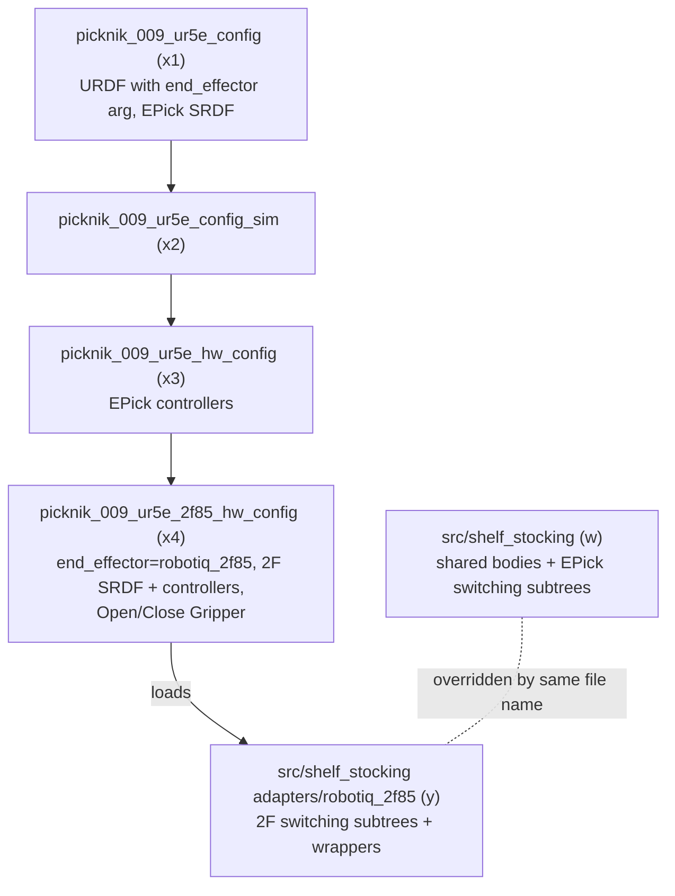

# End Effector Variants

## What it does, at a glance

The UR5e 009 cell can be described with either of two end effectors below `gripper_mount_link`: the Robotiq **EPick** suction gripper (the production setup) or a Robotiq **2F-85** 2-finger gripper. The choice is the `end_effector` xacro arg in [`picknik_009_ur5e.urdf.xacro`](../src/picknik_009_ur5e_config/description/picknik_009_ur5e.urdf.xacro). It defaults to `epick`, so every existing config is unchanged.

The 2F-85 is a separate leaf config, [`picknik_009_ur5e_2f85_hw_config`](../src/picknik_009_ur5e_2f85_hw_config/config/config.yaml). It is `based_on_package: picknik_009_ur5e_hw_config` and replaces only what the gripper changes:

- the `end_effector` urdf param;
- its own SRDF (EPick collision pairs out; the 2F-85 `gripper` group, passive joints and pairs in);
- its own controllers (the 2F-85 `GripperActionController` instead of the EPick controllers);
- its own `frontend_settings.yaml`;
- an `x4_2f85_objectives` library with the gripper's generic `Open Gripper` / `Close Gripper`;
- the shelf-stocking application's 2F-85 adapter, `y_shelf_stocking_robotiq_2f85`: the 2-finger gripper switching subtrees and favourite wrappers. It is application code, so it lives in the submodule's `adapters/robotiq_2f85/`, not here.

The shared shelf-stocking Objectives come from the `src/shelf_stocking` submodule. They reach the gripper only through those switching subtrees and the `grasp_brief` port of their two shared bodies. The contract is in the submodule's [`robot_and_gripper_interface.md`](../src/shelf_stocking/design_docs/robot_and_gripper_interface.md).

## Why this shape

**Why one xacro arg rather than a second robot description.** The arm, the wrist camera mount, the stand and the environment are identical. Everything below `gripper_mount_link` is the only difference, so the switch sits exactly there. Both branches end in a `grasp_link` with +Z along the approach, the frame the shared Objectives plan to.

**Why the variant is a leaf of the hardware config.** It inherits the arm driver, the cameras, the calibration and the cell scene unchanged, and differs in four files. An end-effector variant of the sim config would be a sibling leaf of `picknik_009_ur5e_config_sim`, but there is no MuJoCo model of the 2F-85 in this scene yet.

**Why the SRDF and controllers are copies.** `config.yaml` inheritance replaces whole file references, so the variant cannot drop the EPick entries from the inherited SRDF and controllers file. The copies carry a header naming their source; the arm sections must be kept in step with it by hand.

## Notes and gotchas

- **The 2F-85 runs on the real `robotiq_driver`.** The `ros2_robotiq_gripper` submodule tracks upstream `main`, which builds on Jazzy (see [`moveit_pro_10_build.md`](moveit_pro_10_build.md)). Setting `gripper_use_fake_hardware` to true in the leaf's `config.yaml` still puts the fingers on `mock_components` with the arm real, which is the way to run the Objectives with no gripper on the wrist.
- **The 2F-85 talks over the Robotiq USB-RS485 bridge, not the UR tool port.** Its serial device is the `robotiq_2f85_com_port` xacro arg, set in the leaf's `config.yaml` to the same FTDI bridge the EPick used (`epick_usb_port`). The robot xacro used to hand it `tool_device_name`, the `ur_robot_driver` tool-communication pseudo-terminal, which nothing on this cell is wired to. If the gripper is ever moved onto the wrist's tool connector, point the arg at `tool_device_name` and set the tool I/O on the teach pendant to RS485 for user control.
- **`robotiq_description` on `main` renamed the macro's `sim_ignition` param to `sim_gazebo`.** Passing the old name is a hard xacro error (`Invalid parameter`), not a silent no-op, so a submodule bump that touches the macro args fails at stack start, not in the build.
- **Nothing on the 2F-85 reports a grip.** Its `Check Grasp Status` always succeeds, so a missed grasp is only noticed when the product is not in the tote. The driver reports finger position, so the obvious signal is the knuckle joint closing short of fully closed.
- **The 2F-85 Objectives are untested on hardware.** Treat these as starting points: the grasp depth past the Gemini point, the advance from the pre-grasp pose (the two must agree), the shelf approach along the flipped front-face normal, and the 2-finger Gemini briefs.
- **The suction-only Objectives still list under the 2F-85 config.** `Shelf Stocking - VLA Collection`, the cracker-box collection, the Assisted unshelving and the policy rollouts call the EPick directly. Under the 2F-85 they fail at the first vacuum command. The 2F-85 config also leaves out the EPick-only `policy_state_broadcaster`, so none of the VLA tooling applies to it.
- **The 2F-85's mesh links are named `robotiq_85_*`.** The 2F `Attach Held Product` lists them as `touch_links`. If the Robotiq description is bumped and renames them, the attach still succeeds but the planner sees the held box in collision with the fingers.
- **`frontend_settings.yaml` does not inherit,** so the variant carries its own copy of the hardware config's pane list. Keep the two in step.
- **Switching end effector means switching config package** (`MOVEIT_CONFIG_PACKAGE`), not editing a value: the URDF, SRDF, controllers and Objectives have to change together.
