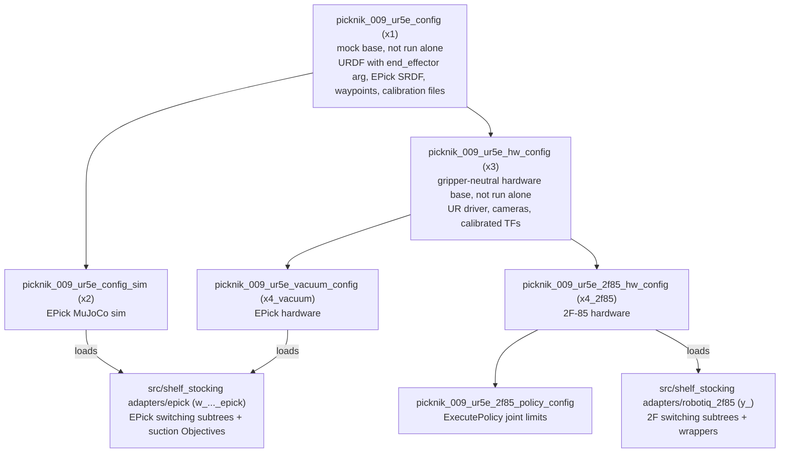

# End Effector Variants

## What it does, at a glance

The UR5e 009 cell can be described with either of two end effectors below `gripper_mount_link`: the Robotiq **EPick** suction gripper (the original cell, no longer built) or a Robotiq **2F-85** 2-finger gripper (the cell in use). The choice is the `end_effector` xacro arg in [`picknik_009_ur5e.urdf.xacro`](../src/picknik_009_ur5e_config/description/picknik_009_ur5e.urdf.xacro). It defaults to `epick`, which is what the mock base, the sim and the vacuum config use.

Each gripper has its own config package, and the hardware base below them carries nothing gripper-specific:

- **`picknik_009_ur5e_hw_config`** is the real-hardware base: the UR driver and camera drivers launch, the shopping list server, the fixed-camera transforms published from `cell_calibration.yaml`, the robot IP and tool settings, the calibrated kinematics, and the gripper-neutral hardware Objectives (`Get Bin Image`, `Get Bin Point Cloud`, the no-op `Randomize Sim Products`, `Calibrate Fixed Camera From Known Board`). It has no `ros2_control` section and no `frontend_settings.yaml`; both belong to the gripper.
- **[`picknik_009_ur5e_vacuum_config`](../src/picknik_009_ur5e_vacuum_config/config/config.yaml)** is the EPick hardware leaf: the EPick controllers, a drivers launch that includes the hardware one and adds the EPick seal relay, the pane list, the real `Check Epick Grasp Status`, the wrist-D415 `Get Wrist …` subtrees and `Check Camera Feeds`. It loads the submodule's EPick adapter.
- **[`picknik_009_ur5e_2f85_hw_config`](../src/picknik_009_ur5e_2f85_hw_config/config/config.yaml)** is the 2F-85 hardware leaf. It overrides:
  - the `end_effector` urdf param;
  - its own SRDF (EPick collision pairs out; the 2F-85 `gripper` group, passive joints and pairs in);
  - its own controllers (the 2F-85 `GripperActionController` instead of the EPick controllers);
  - its own `frontend_settings.yaml`;
  - an `x4_2f85_objectives` library: the gripper's `Open Gripper` / `Close Gripper`, the PC-specific favourites that run `Collect Unshelve Episodes` with other settings (the GraspScout trial detector, the Qualcomm NPU segmentations, the Order Fulfillment demos), and the cell's calibration and scene Objectives. The GraspScout favourites live here, not in the adapter, because the trial server runs on this cell's PC only;
  - the shelf-stocking application's 2F-85 adapter, `y_shelf_stocking_robotiq_2f85`: the 2-finger gripper switching subtrees, `Collect Unshelve Episodes` and the other favourite wrappers. It is application code, so it lives in the submodule's `adapters/robotiq_2f85/`, not here;
  - the 2F-specific driver launch wrapper and `Get Wrist …`, camera-check, calibrated-scene and calibration Objectives: these select the Orbbec Gemini 305 as wrist RGB-D and the single available D415 as `scene_camera`, calibrate the Orbbec from the shelf-mounted ChArUco board with MoveIt Pro 10.2 tools, then calibrate the scene D415 separately from the accepted board pose, remove the EPick cell's table-side camera-rig boxes (`vla_cam_rig_*`, see [`vla_scene_cam_rig.md`](vla_scene_cam_rig.md)), and add the 2F-85 cell's stand-corner pole as planning-scene collision geometry.

The shared shelf-stocking Objectives come from the `src/shelf_stocking` submodule. They reach the gripper only through the switching subtrees and the `grasp_brief` port of their shared bodies. Each gripper's adapter folder provides the full set of switching subtrees; the shared `objectives/` folder no longer holds EPick defaults. The contract is in the submodule's [`robot_and_gripper_interface.md`](../src/shelf_stocking/design_docs/robot_and_gripper_interface.md). How the library ids decide which same-named file wins is in [`objective_library_precedence.md`](objective_library_precedence.md).

## Why this shape

**Why one xacro arg rather than a second robot description.** The arm, the wrist camera mount, the stand and the environment are identical. Everything below `gripper_mount_link` is the only difference, so the switch sits exactly there. Both branches end in a `grasp_link` with +Z along the approach, the frame the shared Objectives plan to.

**Why the hardware base is based on the mock config, not the sim.** A child config inherits everything its parents load. MoveIt Pro 10's config merge lets a child replace a parent's `objective_library_paths` entry but never remove one (`get_objective_library_locations` in the Runtime's `moveit_studio_utils_py/system_config.py`). The sim is a suction sim, so with the sim in the hardware chain its Objectives and the EPick adapter would list under the 2F-85 too. Every sim Objective already had a hardware override, and the sim's other settings are either overridden by the hardware config or ignored on real hardware, so taking the sim out of the chain loses nothing.

**Why the EPick hardware is its own leaf and the hardware base is gripper-neutral.** For the same reason: anything suction-specific in the shared hardware base would be inherited by the 2F-85, with no way to drop it. So the suction controllers, the seal relay, the pane list and the D415 wrist subtrees moved down into `picknik_009_ur5e_vacuum_config`, and the hardware base keeps only what both grippers use.

**Why the suction Objectives sit in their own adapter folder.** The suction-only Objectives (the EPick main application, the grasp and lean recoveries, `Activate Vacuum` / `Deactivate Vacuum`, the EPick switching subtrees) are kept, but only the sim and the vacuum config load `adapters/epick`. They do not list under the 2F-85, and the 2F-85's `Open Gripper` / `Close Gripper` do not list under the suction configs.

**Why the SRDF and controllers are copies.** `config.yaml` inheritance replaces whole file references, so the 2F-85 cannot drop the EPick entries from the base SRDF and controllers file. The copies carry a header naming their source; the arm sections must be kept in step with it by hand. The vacuum config's controllers are the hardware file that used to sit in the hardware base.

An end-effector variant of the sim would be a sibling leaf of `picknik_009_ur5e_config_sim`, but there is no MuJoCo model of the 2F-85 in this scene yet.

## Notes and gotchas

- **Neither the mock base nor the hardware base is meant to be run.** They load no gripper adapter, so they do not resolve every switching subtree. The hardware base has no `ros2_control` section, so it inherits the mock base's EPick controller list. A new gripper leaf on top of it must set its own `ros2_control`, controllers file and `frontend_settings.yaml`.
- **Run the vacuum config, not the hardware base, for the EPick:** `moveit_pro run -c picknik_009_ur5e_vacuum_config`. The Trainer Training Config `picknik_009_ur5e_hw_config.json` in the submodule keeps its old name on purpose: it is a Trainer config name that existing datasets pin, not a package path.
- **Policy rollouts run under a leaf of the 2F-85 leaf.** `picknik_009_ur5e_2f85_policy_config` is the 2F-85 config with the arm acceleration limits raised for `ExecutePolicy`; see [`policy_session_config.md`](policy_session_config.md).
- **The 2F-85 runs on the real `robotiq_driver`.** The `ros2_robotiq_gripper` submodule tracks upstream `main`, which builds on Jazzy (see [`moveit_pro_10_build.md`](moveit_pro_10_build.md)). Setting `gripper_use_fake_hardware` to true in the leaf's `config.yaml` still puts the fingers on `mock_components` with the arm real, which is the way to run the Objectives with no gripper on the wrist.
- **The 2F-85's finger speed and grip force are stack-start settings, not per-command.** They are the `robotiq_2f85_speed_multiplier` and `robotiq_2f85_force_multiplier` xacro args, set in the leaf's `config.yaml` and read once by `robotiq_driver`; the gripper action only carries a position, and the driver's `set_gripper_max_velocity` / `set_gripper_max_effort` command interfaces are claimed by no controller, so nothing in a BT can change them. The speed applies to opening as well as closing. It is slowed from the driver's full speed because the pads struck the round mustard bottle and pushed it back out of the fingers before the grip built up; the 2F-85's tips also swing forward as the fingers close, so a fast close drags a round product toward the back of the shelf. A change needs a stack restart.
- **The 2F-85 talks over the Robotiq USB-RS485 bridge, not the UR tool port.** Its serial device is the `robotiq_2f85_com_port` xacro arg, set in the leaf's `config.yaml` to the same FTDI bridge the EPick used (`epick_usb_port`). The robot xacro used to hand it `tool_device_name`, the `ur_robot_driver` tool-communication pseudo-terminal, which nothing on this cell is wired to. If the gripper is ever moved onto the wrist's tool connector, point the arg at `tool_device_name` and set the tool I/O on the teach pendant to RS485 for user control.
- **The 2F-85's serial port is named by the bridge's serial number, not `ttyUSBn`.** The kernel gives a replugged FTDI bridge the next free `ttyUSBn`, and a running drivers container keeps the old one open. So a bridge bumped while the stack is up comes back as `ttyUSB1`. With a `ttyUSB0` path, the next start then aborts `ros2_control_node` with `Cannot configure the Robotiq gripper: IO Exception (2): No such file or directory`. The leaf's `config.yaml` therefore uses the udev `/dev/serial/by-id/` link instead. That link exists only on the host: the privileged drivers container copies device nodes but not udev's symlinks. The workspace [`docker-compose.yaml`](../docker-compose.yaml) bind-mounts `/dev/serial` into `drivers` for this. The link includes the bridge's serial number, so swapping the bridge means editing `config.yaml`; `ls /dev/serial/by-id/` on the host gives the new name. The device node is still a start-time copy, so a bridge that re-enumerates while the stack is running needs a drivers restart either way. The EPick configs still use the xacro default for `epick_usb_port`, a `ttyUSBn` path, and can hit the same renumbering.
- **`robotiq_description` on `main` renamed the macro's `sim_ignition` param to `sim_gazebo`.** Passing the old name is a hard xacro error (`Invalid parameter`), not a silent no-op, so a submodule bump that touches the macro args fails at stack start, not in the build.
- **Nothing on the 2F-85 reports a grip.** Its `Check Grasp Status` always succeeds, so a missed grasp is only noticed when the product is not in the tote. The driver reports finger position, so the obvious signal is the knuckle joint closing short of fully closed.
- **The 2F-85 Objectives are untested on hardware.** Treat these as starting points: the grasp depth past the Gemini point, the advance from the pre-grasp pose (the two must agree), the shelf approach along the flipped front-face normal, and the 2-finger Gemini briefs. The Orbbec mount still starts from the prior D415 camera-body estimate until the new 2F camera configuration is deployed; run and review the [shelf-board calibration workflow](orbbec_shelf_board_calibration.md), then verify its color-registered cloud before relying on wrist-derived 3D grasp poses.
- **The VLA tooling built for the suction cup does not apply to the 2F-85.** The 2F-85 config leaves out the EPick-only `policy_state_broadcaster` and the seal relay.
- **The 2F-85's mesh links are named `robotiq_85_*`.** The 2F `Attach Held Product` lists them as `touch_links`. If the Robotiq description is bumped and renames them, the attach still succeeds but the planner sees the held box in collision with the fingers.
- **`frontend_settings.yaml` does not inherit,** so each runnable leaf carries its own pane list: the sim, the vacuum config, the 2F-85 config, and `picknik_009_ur5e_2f85_policy_config` with a copy of the 2F-85's. Keep the 2F-85 pair in step. The 2F-85 copies add the [Unshelve Episodes](../src/shelf_stocking/design_docs/unshelve_episodes_pane.md) pane, which the EPick configs leave out because nothing drives it there.
- **Switching end effector means switching config package** (`MOVEIT_CONFIG_PACKAGE`), not editing a value: the URDF, SRDF, controllers and Objectives have to change together.
