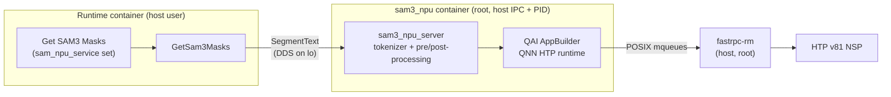

# IQ10 SAM3 NPU Sidecar

## At a glance

On the IQ10 (`qc-ubuntu-pr`, a Qualcomm QAM8797P with an HTP v81 NPU), SAM3 runs on the NPU in a root sidecar container, `sam3_npu` in the workspace [`docker-compose.yaml`](../docker-compose.yaml). The sidecar runs [`sam3_npu_server`](../src/sam3_npu_server/sam3_npu_server/server.py). It loads a merged SAM3 QNN context binary once through Qualcomm's QAI AppBuilder and serves the `shelf_stocking_msgs/SegmentText` service. The `GetSam3Masks` Behavior calls that service whenever the `Get SAM3 Masks` subtree is given a `sam_npu_service` (the submodule's `design_docs/sam3_service_segmentation.md`). [`Order Fulfillment Demo (IQ10)`](../src/picknik_009_ur5e_2f85_hw_config/objectives/order_fulfillment_demo_iq10.xml) is the Objective that sets it. The favourite [`Order Fulfillment Demo - Shopping List (IQ10)`](../src/picknik_009_ur5e_2f85_hw_config/objectives/order_fulfillment_demo_shopping_list_iq10.xml) runs the same settings in a loop that fills each order placed in the Shopping List pane (the submodule's `design_docs/shopping_list.md`); keep the two in step. One text prompt takes under 2 s on the NPU, against 25 to 33 s on the board's CPU.

The sidecar only exists with the `sam3_npu` compose profile active, so nothing changes on any other machine. Host setup (the model file, AppBuilder, the profile) is in [`computer_setup/qc_ubuntu_pr_2f85_hw_setup.md`](../computer_setup/qc_ubuntu_pr_2f85_hw_setup.md). The board-side recipe follows Qualcomm's "IQ10 dev board NPU container result" write-up, and the shape follows the robot 1 port in `qcc-iot/qc-robotics` (`pr/ces/robot1/mip-integration`, commit `325228f9`).

## Why this shape

- **Root, because the board allows nothing else.** On this BSP an NPU client talks to the root `fastrpc-rm` daemon over POSIX message queues, and the daemon creates each session's queues `0644 root`. A uid 1000 client gets `EACCES` and QNN reports `Device Creation failure`. A `UMask=` drop-in on the daemon does not help: it passes that mode explicitly. The client must also `pidfd_getfd` buffers out of the root daemon, which needs `CAP_SYS_PTRACE`. The Runtime runs its models as the host user, so it cannot use the NPU on any image. Running the whole Runtime as root was rejected. A small root process that only segments images keeps root confined.
- **A sidecar on the host IPC and PID namespaces with read-only board files, not `--privileged`.** The queues are host POSIX queues whose names embed the client's host PID, hence `ipc: host` and `pid: host`. The client needs the board's own `libcdsprpc.so`, `libkiumd.so` and `liblrmc.so` (without the last, QNN reports "No NSP cores detected"), the HTP skeletons in `/usr/lib/rfsa`, and the DSP shell on the `/vendor/dsp` partition. No device nodes are involved. This is the IQ-9075's `qnn-compose.yaml` path turned inside out: that one mounts device nodes into a non-root Runtime, which the IQ10 does not offer.
- **A ROS service, not an HTTP server.** The Runtime already reaches everything else over DDS, and a service needs no port, CORS or credentials. It also lets the Behavior be a plain `ServiceClientBehaviorBase` with a timeout and a halt. The sidecar extends the installed `base` service, so it shares the Runtime's image, host networking, `ROS_DOMAIN_ID` and DDS settings. It runs Pro's own `setup_workspaces.sh` and `copy_dds_configs.sh` because the image entrypoint is skipped.
- **QAI AppBuilder with its bundled QNN runtime, not ONNX Runtime's QNN provider.** The context binary loads directly, with nothing wrapped in an `EPContext` ONNX graph, and stays loaded between requests. The wheel is one download that carries its QNN host libraries and the V81 stub and skeleton, so the sidecar depends on no other team's QNN folder. It runs on the image's own Python, with the image's NumPy.
- **Our own tokenizer, not Meta's `sam3` package.** That package needs torch only to return the token tensor. [`tokenizer.py`](../src/sam3_npu_server/sam3_npu_server/tokenizer.py) is a dependency-free port that gives the same ids for every prompt in its test data. The test data was generated from Meta's tokenizer: every `exemplars.yaml` description plus edge cases. CLIP's vocabulary (MIT) ships in the package's `assets/`.
- **One merged graph per prompt.** The context holds the vision backbone, text encoder and decoder as one graph. It takes the image and 32 tokens and returns presence, 200 boxes, 200 logits and 200 masks at decoder resolution. So every prompt re-runs the vision backbone; the pick sends one prompt per call anyway. Scoring and mask upscaling follow MoveIt Pro's `SAM3Detect`, so the two backends give the pipeline the same kind of masks.
- **A compose profile plus `required: false`.** `moveit_pro run` starts named services and their dependencies, so the sidecar has to be a dependency of `runtime` to start with the stack. `required: false` makes that dependency vanish where the profile is off. The profile is switched on from the shell environment (`COMPOSE_PROFILES`), which the CLI passes through, rather than from the workspace `.env`, whose reserved `COMPOSE_*` keys the CLI warns against.

## Notes and gotchas

- **Set the `CDSP*_LIBRARY_PATH` variables, not only `ADSP_LIBRARY_PATH`.** With only the latter set, the NSP domains cannot find the skeleton: QNN logs `openSessionForPriority failed ... 0x80000406` and `Device Creation failure`, which looks like the root-permission failure but is not. `start_sam3_npu.sh` sets all of them, as Qualcomm's `qcrun` wrapper does.
- **AppBuilder reports a failed context load only in its log.** It goes on with an empty model, and every inference returns nothing. The server therefore checks the loaded graph's input and output names and exits if they are not the merged SAM3 graph's, rather than serve empty masks.
- **AppBuilder and the QNN libraries must be the same release.** An AppBuilder newer than the QNN backend fails with "Unable to find a valid interface". The context binary was compiled with an older QAIRT than either, and newer QNN runtimes load older contexts. On 2026-11-19 the bundled 2.51 runtime and the board's 2.50 one gave masks with an IoU of at least 0.998 and the same detections.
- **The context targets this chip.** It is compiled for HTP v81 and one core. An IQ-9075 (iq9-1, HTP v73) cannot load it, and that board does not need the sidecar: its Runtime reaches the NPU directly (`qualcomm_npu_segmentation.md`).
- **A wedged DSP looks like a container problem.** When the sidecar fails with `Error in getting response from DSP, err:-11` or `dsp proc_init failed`, check whether a host root QNN run fails too (the runbook has a quick check). `journalctl -u fastrpc-rm` showing `Glink RM ... open failed ... -11` or `CB exhausted for signed PD` means the DSP side is stuck, and only a reboot has cleared it. The restart policy stops after a few attempts for that reason; restarting more does not help and may leave DSP buffers allocated, as on iq9-1.
- **FastRPC's own error messages go to `/dev/log`,** which the container does not have, so a failing start shows only QNN's summary. Qualcomm's probe binds a small `AF_UNIX` datagram listener at `/dev/log` inside the container to see them. Do that when debugging; do not bind the host's syslog socket in.
- **The sidecar keeps running when the CLI stops the stack.** `moveit_pro run`'s shutdown stops the services it started by name (`runtime`, `drivers`), not their dependencies; `moveit_pro down` stops everything when the profile is active. A long-lived sidecar is fine, because the context is loaded once, but it serves the workspace code that was installed when it started. Recreate it (`docker compose ... up -d --force-recreate sam3_npu`, or stop it and run the stack again) after rebuilding `sam3_npu_server` or `shelf_stocking_msgs`.
- **The start script is run from the workspace source tree** (`src/sam3_npu_server/scripts/`), and the Python module and the service type from the workspace install. So the sidecar needs a built workspace, like the Runtime.
- **The model and AppBuilder are host files, not git.** `SAM3_NPU_DIR` (default `~/sam3_npu`) holds `sam3_merged.bin` and the unpacked wheel. The context is a SAM3 derivative under Meta's SAM License; AppBuilder is BSD-3-Clause. Neither is redistributed from this repo.
- **The image is stretched to the model's square input,** as Pro's SAM3 path does, so masks come back at the request image's own size and aspect. The server accepts `rgb8`, `bgr8`, `rgba8` and `bgra8` images.
- **The NPU is shared.** The GR00T rollout's root inference server on this board uses the same NSP. Running both at once is untested.
