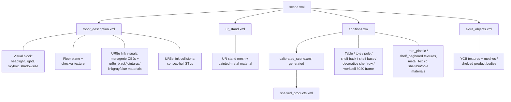

# Sim Visuals

How the MuJoCo `picknik_009_ur5e_config_sim` scene is dressed: which assets
contribute to the rendered look, where each material lives, and the lighting
recipe. The goal here is photoreal-ish "grocery store with a robot in it",
not photorealism — but enough specular/shadow/skybox cues that an operator
demoing the sim doesn't read it as a flat-shaded toy.

## What is loaded at execution time

`mjcf/scene.xml` is the entry point. It includes four fragments that together
populate the worldbody, materials, and visual block:

| Fragment | Owns |
|---|---|
| `assets/robot_description.xml` | UR5e + EPick + camera-adapter chain, ground plane, skybox, headlight, key/fill lights |
| `assets/ur_stand.xml` | UR pedestal mesh and its painted-metal material |
| `assets/additions.xml` | Table, workcell, camera mount plate, overview camera, and the materials/textures of everything below |
| `assets/calibrated_scene.xml` | Generated at build time from `templates/calibrated_scene.xml.in`: tote, shelving and its four flanking rows, scene camera and ZED at the calibrated poses (see `mujoco_sim_config.md`) |
| `assets/shelved_products.xml` | The decorative products on the flanking shelves, placed inside a body that follows the calibrated back wall |
| `assets/extra_objects.xml` | Free YCB products with per-object texture maps |

Texture and visual-mesh files referenced by these fragments:

| File | Where used |
|---|---|
| `mjcf/assets/textures/tote_plastic.png` | Tileable 256×256 industrial-plastic gray with subtle noise + faint horizontal mold ribs, used as the `bin_material` for the calibrated_bin's five wall/bottom geoms AND for the calibrated_table top + sides. Generated by `generate_tote_plastic.py`. |
| `mjcf/assets/textures/generate_tote_plastic.py` | Generator for `tote_plastic.png`; deterministic, edits to `BASE` / `RIB_*` / `NUM_RIBS` constants control the look. |
| `mjcf/assets/textures/shelf_pegboard.png` | 512×512 cream-painted-steel pegboard with a 20×20 hole grid; bound to `shelf_pegboard_material`, only used by `shelf_back`. Generated by `generate_shelf_pegboard.py`. |
| `mjcf/assets/textures/generate_shelf_pegboard.py` | Generator for `shelf_pegboard.png`. Edit `GRID`, `HOLE_RADIUS`, `BG` to retune. |
| `mjcf/assets/textures/grocery_skybox.png` | 1024×768 cube-unfold skybox (gridsize="3 4" gridlayout=".U..LFRB.D..") with a bright cool-white industrial-ceiling top cell and four horizon-view side cells stacking ceiling / banner zone / product wall / lower shelving / floor. Generated by `generate_grocery_skybox.py`. |
| `mjcf/assets/textures/generate_grocery_skybox.py` | Generator for `grocery_skybox.png`. Re-run to reroll per-side banner placement and product-band spacing; the palette / zone-percentage knobs at the top of the file control the tone. |
| `mjcf/assets/textures/sheet_metal.png` | Painted-metal pole |
| `mjcf/assets/textures/marble1.png` | Vendored but not currently bound — held in reserve for a vinyl-tile floor variant |
| `mjcf/assets/ur5e_visual/*.obj` | mujoco_menagerie split-by-color visual meshes for the UR5e |

The textures and OBJ meshes are vendored locally into this package (the OBJ
meshes from the mujoco_menagerie UR5e model), copied in so that the install
share tree is self-contained (no `<compiler texturedir>` indirection or path
substitution).

## UR5e visual mesh strategy

Each UR5e link has two kinds of geom in `robot_description.xml`:

1. **Visual** (`group="2"`, `contype=0`, `conaffinity=0`, `density=0`) — a stack
   of mujoco_menagerie OBJ meshes, one per painted region (UR-blue, joint-gray,
   link-gray, black). Materials carry small `specular`/`shininess` so the arm
   reads as polished plastic instead of flat paint.
2. **Collision** — the original convex-hull STL exported from the URDF.
   Single mesh, no material, `group="3"`. Untouched.

The visual OBJs are positioned with the **same `pos`/`quat` as the original
visual STL** the link used to render. This works because both meshes derive
from the same Universal Robots CAD source and share the URDF mesh-frame
convention (verified visually). If a future menagerie update re-exports the
OBJs in a different mesh-frame, every UR5e visual `pos`/`quat` in
`robot_description.xml` will need to be updated in lockstep.

The collision STL is intentionally kept — replacing it with a stack of
primitive capsules (the menagerie pattern) would change collision behavior
and is a separate decision.

## Floor + skybox

The floor is a `<plane>` with a procedural `builtin="checker"` texture in
cream/gray tones, sized so the visible tiles read as roughly sub-meter shop
flooring rather than chessboard squares. Reflectance is intentionally turned
off: with the warm grocery skybox in place, even a small reflectance value
washed the floor toward white at most camera angles and killed the contrast
under the robot. The procedural checker also no longer paints per-tile edge
marks, because the dark single-pixel edges aliased into wavy Moiré bands at
grazing camera angles under mipmap minification. See the `floor_material`
material in `assets/robot_description.xml` for the current colors and tile
size.

The skybox is a file-based cube-unfold (`grocery_skybox.png`) loaded as
`<texture type="skybox">` with a `gridsize`/`gridlayout` net. The design
goal is to mimic the **far background** of a real grocery-store interior —
the fixtures and displays you'd glimpse looking past the working shelf, not
a single wall surrounding the robot. Each side cell stacks five conceptual
zones from top to bottom: a bright cool-white industrial **ceiling**
crossed by truss / I-beam lines and dotted with several small fluorescent
fixtures (this fills the largest share of the cell — real grocery ceilings
read bigger than people expect); a **banner zone** of hanging signage in
mixed grocery-aisle colors, each banner drawn with a thin suspension cable
up into the ceiling so it reads as hanging; a **product wall** of vertical
bands in mixed produce / packaged-goods colors over a warm tan ground,
broken by a far-shelf line and a few dark end-cap blobs; a **lower
shelving** band in dark wood tones with thin vertical separators; and a
final **floor** strip in cool gray. The top cell renders the same ceiling
in plan view (truss grid, one fluorescent per cell, scattered
suspended-fixture dots); the bottom cell is solid floor gray and is rarely
seen because the floor plane sits over it.

This iteration replaces an earlier "tall tan walls" version where a
50%-tall saturated-tan shelving band dominated each cell and read as a
near wall surrounding the robot rather than as distant fixtures behind the
working scene. That version itself replaced an even earlier
procedural-gradient skybox that read as "outdoor at dusk" rather than
"indoor warehouse". A small Gaussian blur softens each cell's geometry so
the shapes read as out-of-focus distant fixtures rather than as crisp UI
elements. See the skybox `<texture>` declaration in
`assets/robot_description.xml` and the generator at
`mjcf/assets/textures/generate_grocery_skybox.py`.

### Decorative shelving row

The center workcell shelf (`calibrated_top_shelf` / `calibrated_bottom_shelf`
/ `shelf_back` / `shelf_base`) is flanked on each side by two visual-only
copies — four decorative units total — at lateral offsets that line them
up into a continuous grocery-aisle row alongside the working shelf. Each
decorative unit is dressed with rows of YCB grocery products (cans,
bottles, boxes) sitting directly on its top and bottom shelf surfaces, so
the operator's view past the working shelf reads as a stocked aisle rather
than as bare metal racks.

Every shelved product is visual-only: a single mesh `<geom>` with
`contype="0" conaffinity="0"` and `group="2"`, no `<freejoint>`, no
`<inertial>`, and no collision counterpart geom. The decorative shelves
themselves use the same convention. Nothing in this row participates in
physics, collides with the robot, or populates the planning scene; the
robot's reachable workspace doesn't extend that far laterally so there is
no risk of a planner ever trying to treat them as obstacles. See the
"Decorative shelf unit" comment blocks in `templates/calibrated_scene.xml.in`
for the per-unit row offsets and `assets/shelved_products.xml` for the
per-product body layout.

Each shelved product body carries an `euler` chosen to point its label
toward the operator (world -Y). YCB texture maps don't follow a single
convention for which mesh-frame face holds the brand label, so the
rotations are per-item-tuned: cans and bottles get pure-Z rotations
(±90° / 180° about world Z), boxes that should stand upright with their
broad face forward get an X-tip composed with a per-item Z rotation, and
the flat boxes (jell-o, pudding) are tipped onto their narrow edge with
an additional world-Y rotation so the face that was on top is now on the
operator-facing side. When tweaking these, watch out for the eulerseq
gotcha in the **Notes and gotchas** section.

### Workcell frame: 9-box approximation + overhead ring-light disk

The 80/20 aluminum frame above the table (the `calibrated_workcell`
body) is rendered as a small set of axis-aligned boxes — two back-wall
vertical posts, three front-to-back rails connecting them (bottom, mid at
z=0.66 where the scene-camera mount sits, top), four bottom-frame rails
forming a rectangle on the table, and one top transverse crossbeam
cantilevering forward over the workspace. The source mesh
(`mjcf/assets/workcell.stl`, ~14k triangles) is preserved on disk
as the dimensional spec but is not loaded by MuJoCo; the box sizes and
positions come directly from per-extrusion bounding boxes of that mesh.

Hanging from the underside of the top crossbeam is the overhead ring light
— in the source mesh an annulus (OD≈0.46, ID≈0.34, axial thickness 0.076)
oriented with its axis along workcell-Z. The simplification approximates
this as a solid stand-in (no hole); good enough for the overhead
silhouette but doesn't read as a true ring.

The MJCF and URDF sides use different primitives for the same disk
because of a 3D-Visualizer rendering quirk: the MJCF (`additions.xml`)
uses a `<geom type="cylinder">`, which MuJoCo renders as a proper flat
disk. The URDF (`workcell.urdf`, loaded into the planning scene
by `Load Calibrated Scene`'s AddURDF) uses a `<box>` matching the disk's
bounding box — the MoveIt Pro 3D Visualizer mis-renders URDF
`<cylinder>` primitives whose `length` is much smaller than their
diameter (this disk is 1:6) as bounding ellipsoids, so a box is the
reliable primitive. The collision-footprint difference between a square
and a circle is negligible for a 76 mm-thick overhead element.

If the ring shape (hole) or the true disk profile ever matters for
perception or visual realism, swap the URDF box for a low-poly annular
mesh extracted from component #2 of `workcell.stl`, or a
multi-box segmented ring.

The same 9-box + 1-disk layout is duplicated between
`additions.xml` (MJCF) and `workcell.urdf` (planning scene) —
that's where the original detailed mesh was hurting the MoveIt Pro 3D
Visualizer render rate, and the two views are kept in lockstep so the
sim and the planning scene agree on what the workcell occupies. When
edits land, change both files together.

## Lighting recipe

Three contributors, in order of strength:

1. **Headlight** — the renderer's view-locked light. Restored from
   `specular="0 0 0"` (which made every surface read as dead-matte) to a
   moderate value. Provides general fill and lets specular highlights survive
   when the camera moves.
2. **Key light** — directional, slightly warm, casts shadows. Above and to
   the front-right. This is what produces the pedestal and shelf shadows on
   the floor.
3. **Fill light** — directional, slightly cool, no shadows. Opposite the key.
   Softens the dark side of the robot without flattening contrast.

The `<quality shadowsize offsamples>` block upgrades the shadow map from
MuJoCo's default (visibly blocky on the shelf edges); read the visual block in
`assets/robot_description.xml` for the current size. `offwidth` /
`offheight` only affect offscreen captures (image-server camera publishers);
the live viewer uses its own window resolution.

## What lives where

## Geom group convention

MuJoCo's renderer and viewer use the per-`<geom>` `group` integer (0–5) to
toggle visibility on/off independently — F-keys 0–5 in the viewer flip each
group. This workspace uses the menagerie convention:

| Group | Purpose | Default visibility |
|---|---|---|
| **2** | Visual geoms (`contype=0 conaffinity=0 density=0`) and dual-purpose box/plane geoms that both render and collide (table, tote walls, pole, shelf back/base, floor) | shown |
| **3** | Collision-only geoms — the convex-hull STLs paired with each UR5e visual link, the EPick collision cylinders, the suction-cup margin sphere, the wrist-camera bounding box, and the UR-stand collision mesh | hidden by default |

Group 0 (the MJCF default when no `group` attribute is set) is **not used**
in this workspace — every geom must declare its group explicitly. Reviewers
should reject PRs that introduce a bare `<geom>` without `group=`.

The previous mix (some visuals in group 0, others in group 1; collisions
mostly bare = group 0) made the viewer's F-key toggles useless: F2 only hid
half the visuals, F3 only hid the YCB collisions. After standardization, F2
hides all of "the world" cleanly and F3 reveals the underlying collision
geometry.

## Notes and gotchas

- The vendored OBJ files reference `mtllib Black.mtl` etc. that we don't ship.
  MuJoCo emits a warning and continues — the `material=` on each geom always
  wins over the OBJ's mtllib hint. Don't strip the `mtllib` lines just to
  silence the warning; it makes diffing against future menagerie updates
  noisier than the warning itself.
- `texuniform="true"` projects the texture in world units (good for tiled
  surfaces like the floor). YCB products need `texuniform="false"` (the
  default) so their UV-unwrapped texture maps render correctly — don't change
  the YCB material defs.
- `reflectance` only renders on **planes** and **boxes**, per MuJoCo docs.
  Setting it on a mesh material is silently ignored. The floor and the
  furniture boxes get reflectance; the shelf-mesh visual does not.
- `<rgba>` and `<material>` on the same geom: `rgba` modulates the texture.
  We use this on `pole_material` to tint a textured surface toward a
  warmer/cooler shade without authoring a second texture.
- **Tote wall geometry**: the calibrated_bin is built from five box geoms
  (bottom + four walls). Original definitions had the front/back walls span
  the full bin length AND the side walls span the full bin width, which
  double-counted the four corner pillars and rendered as visible z-fighting
  "double" lines at every corner. The fix is to shorten the front/back wall
  x half-extent so they fit *between* the side walls — the side walls now
  own the corner volumes. Same total internal dimensions, no z-fight. If
  you ever resize the bin, preserve this asymmetry: full-span sides, in-set
  front/back.
- **Cube-unfold textures vs `texrepeat`**: with `type="cube"` + `texuniform`
  + `texrepeat="N N"`, the same texture image gets tiled N×N times in world
  units across every face — a tile-sized image repeated across a larger
  face produces a visible "panel" seam. The fix when you need it is a
  `gridsize`/`gridlayout` cube unfold where the image is the box's net (one
  cell per face), and MuJoCo stretches each cell to fit its face. No
  `texuniform`/`texrepeat` on materials that use a `gridsize` cube — the
  grid IS the layout. (The calibrated_table previously used this trick for
  a wood look; it now shares `bin_material` and reads as the same
  gray-plastic tote surface as the bin.)
- `headlight specular="0 0 0"` (the old default) is the single biggest
  contributor to a "flat plastic" look — never set it back to zero unless
  you specifically want a non-photographic technical-illustration aesthetic.
- The `<global offwidth offheight>` in the visual block is for offscreen
  rendering only; raising it does not help the interactive 3D viewer's
  resolution.
- **YCB materials carry explicit `specular` and `shininess`** values
  (low for paperboard, slightly higher for steel cans and plastic
  bottles). The MuJoCo defaults are too glossy for cardboard
  packaging and combine with the headlight specular term to overlay a
  strong white wash on the texture — the gelatin box reads as a faded
  cyan and the cracker box as a muddy green instead of the saturated
  retail colors the texture map encodes. Don't strip the values back to
  bare `<material name="X" texture="Y"/>` — the texture is supposed to
  carry the appearance.
- **`diaginertia` for primitive-box freejoint YCB bodies** (`cracker_box_static`,
  `sugar_box_static`, `gelatin_box_static`, `pudding_box_static`) comes from the rectangular-box
  principal-moments formula using the measured YCB extents — not from a
  uniform small stub. With the stub, both boxes wobbled in
  place when standing upright in the working bin: the rotational inertia
  was small enough that ordinary contact perturbations produced visible
  oscillation. If you ever reset these for any reason, recompute from
  the box dimensions and don't fall back to the uniform stub.
- **MuJoCo `<compiler eulerseq>` default is intrinsic XYZ** (lowercase
  letters denote rotations in the local / moving frame). For the default
  `eulerseq="xyz"` and `euler="α β γ"`, the resulting rotation is
  `Rx(α) · Ry(β) · Rz(γ)` — each subsequent rotation is in the body's
  already-rotated frame. So when you want to add "θ about world Y" to an
  existing rotation R, you cannot just append θ to the second slot — that
  would rotate about the body's already-tipped Y axis. Compute
  `R_total = Ry_world(θ) · R_existing` as a 3×3 matrix and then decompose
  it to intrinsic XYZ. Worked example from the shelved jell-o / pudding:
  "tip 90° about X, then add 90° about world Y" is `euler="1.5708 0 -1.5708"`,
  not `euler="1.5708 1.5708 0"` (the latter rotates about world Z, since
  the body's Y axis after the X tip points at world +Z). Uppercase
  `eulerseq="XYZ"` switches to extrinsic if you'd rather author
  world-frame rotations directly.
- **`calibrated_bin_tf` carries `rgba="0 0 0 0"`.** This TF marker sits at
  the bottom-center of the calibrated_bin and falls in the middle of the
  scene_camera frustum, where its colored sphere occluded the bin floor in
  every offscreen capture consumed by perception. Forcing it transparent
  keeps the TF wiring intact while leaving the captures clean. The other
  TF marker sites (table, pole, shelves, YCB objects, FT sensor, suction
  cup) sit out of the camera frustum or are otherwise harmless and keep
  their colored renders for scene-authoring and debugging.

## Future work

- **Convex-primitive collisions for the UR5e**: the menagerie ships with a
  small set of capsule/cylinder collision primitives that are much cheaper
  than the current convex-hull STLs. Worth doing once we have a clear
  contact-physics test plan.
- **Real grocery-store floor texture**: the procedural checker gets us 80%
  of the way there. A photographed vinyl-tile or polished-concrete texture
  in `mjcf/assets/textures/` would close the gap. `marble1.png` is already
  vendored as a candidate.
- **HDR / IBL**: not supported by MuJoCo's renderer. The current 3-light rig
  is what's available; more lights cost shadow-map memory.
